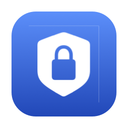

<p align="center">
  
</p>

# MacDuoLock

**为你的 Mac，再加一道锁。**

[](https://github.com/terranc/MacDuoLock/actions/workflows/test.yml)
[](https://github.com/terranc/MacDuoLock/releases/latest)

MacDuoLock 在 macOS 原生解锁后，为桌面加上一层独立密码遮罩。你可以直接输入应用密码，也可以等待附近符合条件的 iPhone 被识别后自动解锁，无需在两种方式之间切换。

它不保存、读取或代输 macOS 登录密码，也不能替你解开 macOS 原生锁屏。

## 为什么做这个项目

这个项目来自我自己的使用习惯：MacBook Pro 有 Touch ID，但接上外接显示器后，我经常合盖使用，没法再碰到指纹传感器，只能反复输入系统密码。为了方便，我实际用过不复杂的密码，家人和孩子也知道它。后来我意识到，自己离家、电脑留在家里时，孩子也可能用这个密码解锁电脑，接触到我的桌面和工作内容。

我希望多一道独立的桌面隐私保护：即使系统密码已经被家人知道，在系统解锁后、进入桌面前，仍需通过 MacDuoLock 的独立密码遮罩。我自己坐在电脑前时，随身携带、登录同一 Apple 账户的 iPhone 可以被识别并自动解除遮罩，减少反复输入密码；iPhone 不在附近时，则保留这道应用密码锁。

无论是在家中、共享居所，还是可能被他人接触的个人办公设备上，它解决的都是“别人知道系统密码，但我仍希望保留一层桌面隐私”的需求。具体保护边界和快捷键行为见下方说明。

## 功能

- **立即输入，后台检测**：系统解锁后立即显示密码界面，同时检测 iPhone；检测期间可随时输入密码，检测超时也不会清空输入。
- **iPhone 在附近自动解锁**：利用同一 Apple 账户下的“连续互通相机”可用状态判断，不需要安装 iPhone 配套应用。
- **手动锁定**：从菜单栏选择“立即锁定”；此次锁定不会被 iPhone 自动解除。
- **全局快捷键**：默认 `⌃⌥⌘` 加反引号键（通常与 `~` 同键），可在设置中自定义。在桌面时锁定，在遮罩中直接解锁。
- **远程控制适配**：默认开启“远程控制时跳过桌面锁定”，识别到远程会话后跳过应用遮罩；也可关闭。
- **简洁的锁定界面**：右下角问号提供自动解锁帮助；输入密码后提交箭头高亮，空输入时保持灰色。
- **菜单栏常驻与登录时启动**：支持多显示器遮罩，按需设置开机登录后自动运行。

## 下载与安装

支持 **macOS 14 或更高版本**，发布包同时支持 **Apple Silicon 和 Intel Mac**。

1. 从 [GitHub Releases](https://github.com/terranc/MacDuoLock/releases/latest) 下载最新的 `.dmg`。
2. 打开磁盘映像，将 **MacDuoLock.app** 拖入 **Applications（应用程序）**。
3. 从“应用程序”启动，设置独立的应用密码，并按提示授权。

当前发布包使用本地 ad-hoc 签名，**尚未经过 Apple 公证**。如果 macOS 提示无法验证开发者，在确认下载来源是本仓库后，可按 [Apple 官方指引](https://support.apple.com/zh-cn/102445)，到“系统设置 → 隐私与安全性”选择“仍要打开”。

### 权限用途

| 权限或设置 | 用途 |
| --- | --- |
| 辅助功能 | 使全局快捷键和遮罩期间的键盘拦截正常工作 |
| 摄像头 | 发现可用的 iPhone 连续互通相机设备；只查询设备列表，不拍照、不录制、不读取视频画面 |
| 登录项 | 在启用“登录时启动”后，允许应用随登录运行 |

可在“系统设置 → 隐私与安全性”管理辅助功能和摄像头权限，在“通用 → 登录项”管理启动设置。

## 如何使用

首次启动时，设置并记住 **MacDuoLock 独立密码**，建议与 macOS 登录密码不同。完成后应用常驻菜单栏，可在“设置”中修改密码、快捷键及登录启动选项。

日常锁定和解锁流程：

1. 按 `⌃⌘Q` 锁定 macOS，或使用系统原生锁屏方式。
2. 用系统密码、Touch ID 等方式解锁 macOS。
3. MacDuoLock 立即显示额外的密码界面。输入应用密码后按回车或点击箭头；符合条件的 iPhone 在附近时，也可等待自动解锁。

菜单栏“立即锁定”只锁定应用遮罩；系统锁屏仍使用 macOS 原生操作。默认全局快捷键也能直接撤下遮罩，请结合下方的保护范围决定是否适合你的使用场景。

### 哪些 iPhone 可以自动解锁？

自动解锁是应用内置能力，没有单独的“开启检测”选项。它依赖 macOS 能发现你的 iPhone 为可用的连续互通相机设备，需要：

- **iPhone XR 或更新机型，运行 iOS 16 或更高版本**。
- iPhone 与 Mac **登录同一 Apple 账户，且账户已开启双重认证**。
- 两台设备彼此靠近，均开启 **Wi-Fi 和蓝牙**。
- iPhone 的“设置 → 通用 → 隔空播放与连续互通”（部分版本称“隔空播放与接力”）中开启 **连续互通相机**。这是默认开启的系统功能。
- 已授予 MacDuoLock 摄像头权限。

“在附近”取决于系统是否能发现连续互通相机，并非固定距离或任意蓝牙设备感应，也不保证每次立即识别。完整条件和故障排查请参考 [Apple 连续互通相机说明](https://support.apple.com/zh-cn/102546)。检测未成功时，直接输入应用密码即可。

## 保护范围

MacDuoLock 是**桌面应用层的额外隐私遮罩**，不替代 macOS 登录安全、原生锁屏或 FileVault 磁盘加密，也不提供系统级防绕过保证。默认全局快捷键可直接解除遮罩，不要求输入密码；拥有系统控制权限的人也可能终止应用。

远程会话识别受远控软件和系统状态影响，**无法保证识别所有远程控制工具**。开启“远程控制时跳过桌面锁定”意味着被识别的远程会话可以绕过此应用遮罩；远程软件自己的系统解锁流程仍由其负责。

## 常见问题

<details>
<summary>iPhone 明明在旁边，为什么还要输入密码？</summary>

先检查同一 Apple 账户、双重认证、Wi-Fi、蓝牙、连续互通相机及摄像头权限。iPhone 的系统状态也会影响发现；例如重启后应先解锁一次，再锁定。可通过菜单栏“检测 iPhone”重试。手动“立即锁定”不会被 iPhone 自动解除。

</details>

<details>
<summary>更新应用后，快捷键或 iPhone 检测失效怎么办？</summary>

在系统设置中检查 MacDuoLock 的辅助功能、摄像头授权及登录项状态。更换本地签名的构建后，macOS 可能要求重新授权；完成授权后退出并重新打开应用。

</details>

## 从源码构建

需要安装 Xcode 16.2 或更新版本，以支持当前工程格式；应用最低支持 macOS 14。工程和 scheme 仍保留 `MacLock` 名称，生成的应用为 `MacDuoLock.app`。

```sh
git clone https://github.com/terranc/MacDuoLock.git
cd MacDuoLock

# 运行测试
xcodebuild test -scheme MacLock -destination 'platform=macOS' \
  -derivedDataPath DerivedData CODE_SIGNING_ALLOWED=NO

# 构建 Release 应用
xcodebuild build -scheme MacLock -configuration Release \
  -destination 'platform=macOS' -derivedDataPath DerivedData \
  CODE_SIGNING_ALLOWED=NO
```

构建产物位于 `DerivedData/Build/Products/Release/MacDuoLock.app`。自行分发或安装前，需按自己的开发环境配置代码签名。

版本变化见 [CHANGELOG](CHANGELOG.md)。问题反馈请使用 [GitHub Issues](https://github.com/terranc/MacDuoLock/issues)。
