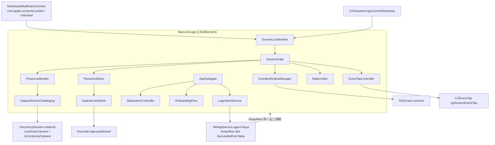
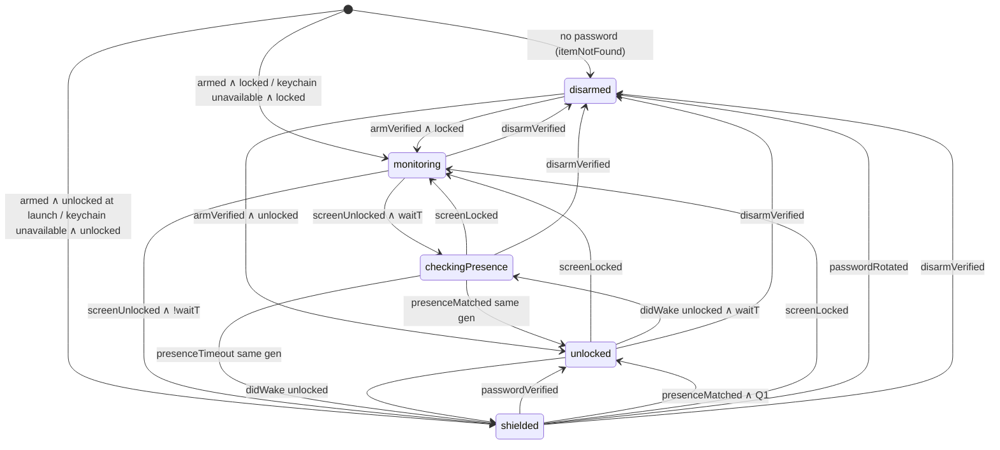
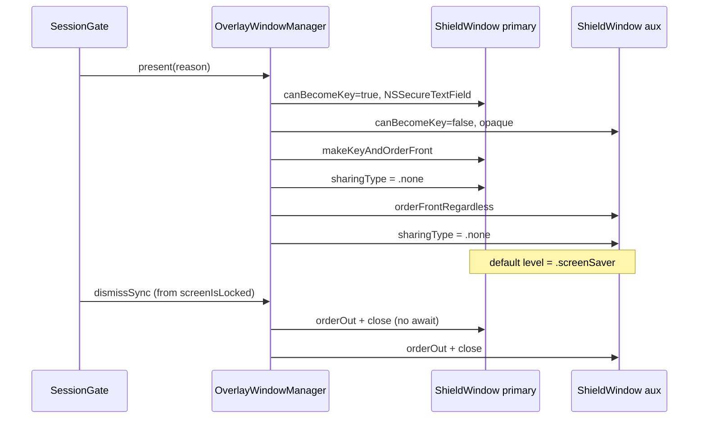
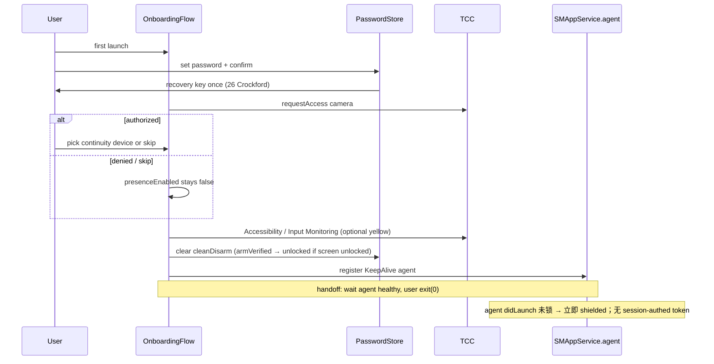
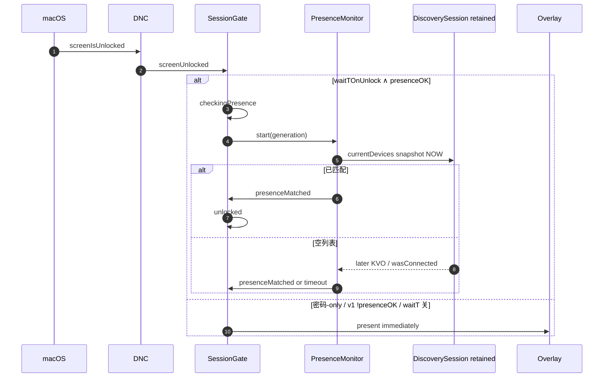
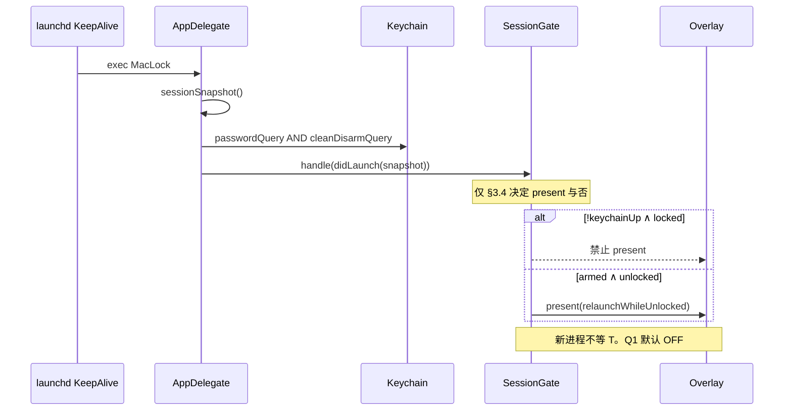
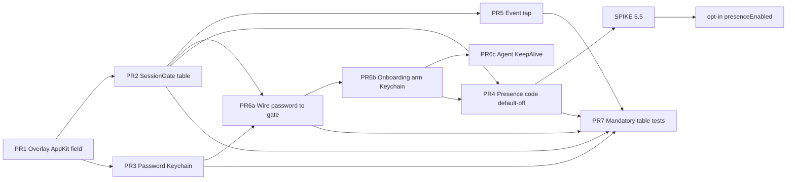

# MacLock Design Document

## Title & Metadata

| Field | Value |
| --- | --- |
| **Title** | MacLock: macOS Post-Unlock Secondary Gate |
| **Author** | TBD |
| **Date** | 2026-08-22 |
| **Status** | Draft |
| **Version** | 0.5 |
| **Product** | MacLock |
| **Deployment target** | macOS 14 Sonoma |
| **Compile SDK** | Latest (macOS 15 Sequoia / macOS 26 Tahoe) |
| **Distribution** | Developer ID + Notarization (**not** Mac App Store) |
| **Workspace** | `/Users/terranc/www/maclock` (greenfield) |

---

## Overview

MacLock 是一个运行在用户态的 macOS 菜单栏应用：在系统锁屏（`loginwindow`）已经解锁之后，再做一次「同一 Apple Account 的 iPhone 是否在附近」的启发式检查。检查手段**仅**为公开的 Continuity Camera 设备枚举，**不**配套 iOS App，**不**使用 Handoff / Instant Hotspot / Unlock with Apple Watch 等私有通道。**禁止**打开 `AVCaptureSession`。

**保证路径是本应用预设口令的全屏遮罩**（与 macOS 登录密码、Touch ID、Apple Watch 解耦）。Continuity Camera 是**机会主义**近场信号：口袋机、Hotspot、AirPlay、Sidecar、低电量下假阴性是一等产品风险，可接受。因 Continuity Camera 要求同一 Apple Account + 2FA（非 Family Sharing），陌生人手机的假阳性预期很低。

v1 **默认密码-only**（`presenceEnabled=false`），直到 Spike §5.5 在 macOS 14 与 26 上记录「桌上、亮屏、BT/Wi-Fi、无绿点、p50 发现 < T」为止。通过后存在检测才可 opt-in。

**v1 默认解锁路径（`presenceOK=false`）：每次 `screenIsUnlocked` 立即遮罩**（再加进程启动时的时钟 A）。wait-`T`（时钟 B）**不是**出厂默认桌面窗口：它只在 `waitT = waitTOnUnlock && presenceOK` 为真时启用（用户已 opt-in 存在检测、相机 `.authorized`、进程已在跑）。`waitTOnUnlock` 键默认 true，是为 Spike 之后准备的，v1 因 `presenceOK` 为假而不生效。

- **进程已在跑** + `presenceOK` + `waitTOnUnlock`：才等 T 秒（默认 3s，范围 1–8s）再遮罩，给桌上 iPhone 枚举机会。
- **进程已在跑** + `!presenceOK`（v1 默认）：立即遮罩。
- **进程在屏幕已解锁且已布防时启动**（登录项冷启动、KeepAlive 拉起、崩溃恢复）：**立即遮罩**，不等 T。

遮罩覆盖全部 `NSScreen`（内建、外接、镜像、Sidecar）。口令控件 v1 使用 AppKit `NSSecureTextField`。

---

## Background & Motivation

### 威胁与现有缺口

macOS 解锁路径（密码 / Touch ID / Unlock with Apple Watch）证明的是「能过系统锁屏的人」，而不是「机主的 iPhone 在身边」。典型场景：同事或孩子知道（或能完成）Mac 解锁，但机主不希望他们在 iPhone 不在附近时使用这台电脑。FileVault 在 OS 解锁后已经解开磁盘——系统锁屏之后桌面即完全可用。

 Continuity、Handoff、Instant Hotspot、「同一 Apple ID 的 iPhone 在附近」**没有公开 API**。Unlock with Apple Watch 绑的是手表，不是 iPhone，且同样不可被第三方 App 查询。

### 为何选 Continuity Camera（以及为何它很弱）

Continuity Camera（macOS 13 / iOS 16 起）把符合条件的 iPhone 后置摄像头暴露为 `AVCaptureDevice`。设备能出现在 Mac 上，隐含：

- 同一 Apple Account（**不是** Family Sharing）
- 该账户已开 2FA
- 双方 Bluetooth + Wi-Fi 开启
- 物理上足够近
- iPhone 上 Continuity Camera 开关开启（默认开）
- 非托管 Apple ID（Managed Apple ID 不支持）

这是目前唯一相对贴近「同账户 iPhone 在附近」的**公开**启发式。它**不是**可靠存在传感器：

| 现实状态 | 对 MacLock 的含义 |
| --- | --- |
| 典型使用：iPhone 在裤袋，人坐在 Mac 前 | Continuity Camera 为「当摄像头」设计；口袋机经常**不出现** → 口令 |
| 经验距离：有时 ~2 ft 才出现，3–4 ft 不稳定 | 超时后走口令，不得空转到无法工作 |
| Personal Hotspot、AirPlay、Sidecar、Internet Sharing | [Apple 文档](https://support.apple.com/en-us/102546) 明确冲突 → 口令 |
| Low Power Mode | 当作不在场 |
| 列表可能需要「唤醒发现」 | **禁止**为此 `startRunning`（绿点）。唤醒失败 → 口令 / 保持密码-only |
| `uniqueID` 跨无线会话可能变化 | v1 匹配 = 粘滞 `uniqueID` **或** 精确 `localizedName`，**无**「任意设备」回退；漏检 → 口令（K1） |

**产品推论（已确认）**：自动放行是锦上添花；口令遮罩是契约。宁可多输一次口令，不可在未检测到时默默放行。

### 当前仓库状态

`/Users/terranc/www/maclock` 为空仓库。本文是实现规格，路径与类型名为**拟定**。

---

## Goals & Non-Goals

### Goals

1. 系统解锁后二次门禁：opt-in 的 Continuity Camera 枚举（默认关）**或**立即/超时后的口令遮罩。
2. 遮罩覆盖全部 `NSScreen.screens`，挡住 Dock / 菜单栏；主屏 AppKit 安全口令框。
3. 口令：PBKDF2-HMAC-SHA256 盐哈希，仅 Keychain；verify-only API。无 Touch ID / Watch / macOS 密码回退。
4. 相机未授权（含 `.notDetermined`）→ 立即密码-only。**门禁热路径禁止 `requestAccess`。禁止 fail-open。**
5. 菜单栏：设置、布防/撤防。撤防 / 改密 / 关 KeepAlive **必须** `PasswordStore.verify` 成功后才写 Keychain。
6. 用 `SMAppService.agent` 拉活，plist 含 `LimitLoadToSessionType=Aqua` 与 `KeepAlive` 字典（`SuccessfulExit=false`）。**单实例协议**见 §9；PR-6c 实证「agent 拉起的 LSUIElement 能否成为 `.screenSaver` key window」，失败则 v1 走独立 200ms/mach helper。
7. Developer ID 公证。不上 Mac App Store。
8. 实现级规格：工程师可按本文 + 公开 SDK 开工，不必发明安全关键行为。

### Non-Goals（明确不做）

| 项 | 原因 |
| --- | --- |
| 配套 iOS App、BLE pairing、Multipeer、Bonjour heartbeat | 用户已否决 |
| 在 `loginwindow` 前拦截；Authorization Plugin | 脆弱、SIP；用户态窗口盖不住登录窗 |
| 磁盘加密、FileVault 替代 | **UI lock**，OS 解锁后卷已开 |
| 防 admin / SSH / `kill` / Recovery / 另一用户 / Keychain 删除 | 超出威胁模型（见绕过面） |
| 走开后自动再锁 | v1 只在 OS unlock / 拉起时检查；走开是 Q2 / v2 |
| 打开 `AVCaptureSession`、预览、麦克风 | 即使发现需要「唤醒」也不开 |
| Mac App Store | event tap + 全屏门禁会被拒 |
| Continuity / Handoff 私有框架 | 无法公证、无法证明 Apple ID |
| Unlock with Apple Watch 当存在信号 | 错误的设备 |
| 用 UserDefaults / 明文文件作为布防开关 | 范围内对手可写（Issue 1） |

### 诚实能力边界（必须在设置/引导中向用户展示；两座时钟分开说）

**时钟 A — 进程启动竞态（非设计意图，只能缩小）：** 登录项 / KeepAlive 从「未在跑」到能 `orderFront` 遮罩，仍可能有约 **0.5–2s** 桌面可见。KeepAlive 不能消灭它。v1 与 opt-in 之后都存在。

**时钟 B — wait-`T`（仅当 `presenceOK`）：** `waitT = waitTOnUnlock && presenceOK`。**v1 出厂 `presenceEnabled=false` → `presenceOK=false` → 每次解锁立即遮罩**，没有 3s 可交互桌面。不得在引导里把「默认每次解锁先空 3s」写成现状。仅当用户在 Spike §5.5 之后打开存在检测、且相机已授权时，才披露「解锁后先尝试检测 T 秒（默认 3s，完全可交互）」。那时口令遮罩是超时之后的保证，不是解锁瞬间的保证。

其它边界：

- 进程可被 Activity Monitor / `kill` / SSH 杀掉。KeepAlive 缩短窗口并在拉起后**立即遮罩**；对 admin 无效。
- Recovery / Safe Mode / 另一用户 / 已解锁 FileVault：不是全盘保护。
- 手势、Control Center、部分系统 UI 可能按 OS 版本泄漏。
- `NSWindow.sharingType = .none` 只挡旧式抓屏；**ScreenCaptureKit（macOS 15+）仍能捕获**。`orderFront` 后必须再写一次 `sharingType`（AppKit 会重置）。
- Event tap + `presentationOptions` 是 best-effort，不是 kiosk。Secure Event Input 聚焦时 tap 可能看不到键。
- 遮罩若在系统锁已出现后仍盖住 `loginwindow`，这是 **P0 缺陷**：电源键硬重启，不是用户技能。见 §6.5。

---

## Key Decisions

| # | 决策 | 理由 |
| --- | --- | --- |
| K1 | **Continuity Camera = 机会主义存在；口令遮罩 = 保证路径** | 无公开「同账户 iPhone 在附近」API。口袋假阴性可接受。 |
| K2 | **用户态 overlay，不是 auth plugin** | 无法盖 `loginwindow`。接受时钟 A。 |
| K3 | **Developer ID，不上 Mac App Store** | event tap / Accessibility / 门禁窗与 MAS 不兼容。 |
| K4 | **v1 只在 OS unlock / 进程拉起时检查** | 走开再锁是 Q2 / v2。 |
| K5 | **口令：PBKDF2-HMAC-SHA256（200_000 次）、16 字节盐、最短 8 字符；只存 Keychain** | 范围内对手拥有已解锁会话；单次 SHA256 + 6 字符不够。verify-only。 |
| K6 | **Event tap 只吞逃逸和弦；口令键放行；放行 ⌃⌘Q** | 遮罩是 key window。IME 切换和弦不吞。让用户回到 `loginwindow`。 |
| K7 | **门禁路径：仅 `.authorized` 才枚举；其余立即密码-only。禁止 `requestAccess`** | TCC 面板不是遮罩；热路径弹窗会与 T 竞态。 |
| K8 | **无 iOS companion** | 用户确认。 |
| K9 | **部署 macOS 14+，编译最新 SDK** | `SMAppService`；2026 年有 macOS 26。 |
| K10 | **v1 匹配 = 粘滞 preferred `uniqueID` 或精确 `localizedName`；无 any-device 回退** | 假阴性 → 口令（K1）。禁止用英文 `"iphone"` 子串当分类器。 |
| K11 | **不启动采集会话** | 绿点不可接受则保持密码-only。 |
| K12 | **布防/撤防/改密/退出登录项：Keychain 位，且仅在 `verify` 成功后写入** | UserDefaults / `state.json` 是范围内绕过。 |
| K13 | **忘记口令 = 恢复密钥（16 字节 Crockford）+ 关登录项。拒绝修饰键后门** | 修饰键对「已坐在桌前」的人是平凡绕过。Q5 关闭。 |
| K14 | **`cleanDisarm` 与口令记录同属 Keychain。KeepAlive 只读 Keychain 三态，不读 UserDefaults** | `unavailable` ≠ `no`；见 K24。 |
| K15 | **三独立开关：`waitTOnUnlock` 默认 ON（仅 `presenceOK` 时生效）；`autoDismissOnPresenceWhileShielded`（Q1）默认 OFF；`immediateShieldOnRelaunchWhileUnlocked` 默认 ON 且 v1 不进设置** | v1 因 `presenceOK=false`，解锁路径是立即遮罩。不得把 A6 与 Q1 合成一旋钮。 |
| K16 | **v1 存在检测默认关，直到 Spike §5.5 在 14 与 26 签字** | 未验证绿点/发现延迟前不把机会主义路径当默认。 |
| K17 | **口令框 v1 = AppKit `NSSecureTextField`，不是 SwiftUI `SecureField`** | accessory + 无边框 + 高层窗口上 SwiftUI 第一响应者不可靠。 |
| K18 | **窗口层级：先 `NSWindow.Level.screenSaver`，实测盖不住再升 `CGShieldingWindowLevel()`** | Apple 不建议普通窗用 shielding；须让位于 `loginwindow`。 |
| K19 | **拉活：`SMAppService.agent` + Aqua + `KeepAlive{SuccessfulExit=false, Crashed=true}`；单实例见 §9；终止分流见 K27（SIGTERM=`_exit(1)` 拉回；Apple Event Quit=`terminateCancel` 不杀进程）。PR-6c 实证失败则 v1 改独立 helper（≤200ms / mach），不是脚注** | 布尔 `KeepAlive: true` + `exit(0)` 会 1s 重启环；默认 `killall`→`exit(0)` 则 **不会** 重启。禁止双 `SessionGate`。 |
| K20 | **副屏 `canBecomeKey = false`；主屏唯一 key window** | 点击副屏不得抢走口令焦点。 |
| K21 | **Desk View / iPad：`allowDeskView` 与 `allowIPad` 独立，默认均 false** | Desk View 用 `deviceType` / `companionDeskViewCamera` 判定，不用英文字符串。 |
| K22 | **恢复密钥有独立 RateLimiter，不与口令 10 次→300s 共用** | 口令轰炸不得把高熵恢复通道锁死 5 分钟。 |
| K23 | **`armVerified` 且屏幕未锁 → `unlocked`，不升起门禁** | 本会话已 `verify`。确认口令在引导窗内完成，不靠立刻遮罩。`didLaunch` 未锁仍立即 `shielded`。 |
| K24 | **Keychain 查询三态 `yes` / `no` / `unavailable`。仅 `errSecItemNotFound` = `no`** | `unavailable` fail-closed 遮罩并退避重试，**禁止**当成无口令去引导。 |
| K25 | **`didWake` 一律按新的 `screenUnlocked` 策略重新上门（从合成 `monitoring`）** | 睡眠中漏 DNC 不得让 `unlocked` 跨过一轮。系统「睡眠不锁屏」的机器睡醒也会见门禁——对本威胁模型是故意的。 |
| K26 | **`recoveryVerified`：遮罩不拆，先轮换口令+恢复密钥，再允许 `disarmed`。PBKDF2 离开 MainActor；摘要恒定时间比较** | `destroy()` 不得早于新哈希落地。 |
| K27 | **允许 `exit(0)` 的三条路径：handoff 用户实例、agent 等用户实例超时（`agentDuplicateTimeout`）、`unregister()` 之后的「退出并关闭登录项」。其余默认 `quitIntent == .none`：Apple Event/菜单 Quit → `.terminateCancel`；SIGTERM/`killall` → `_exit(1)`。终止路径不重查 Keychain；`unavailable` ≠ 撤防** | 否则 `killall`→`exit(0)` 后门禁消失，或 agent 超时 `_exit(1)` 造成引导期重启环。 |

---

## Proposed Design

### 1. 仓库与模块布局

```
/Users/terranc/www/maclock/
  MacLock.xcodeproj/
  MacLock/
    App/
      MacLockApp.swift
      AppDelegate.swift
      ProcessRole.swift              // --role=agent vs user; singleton handoff
      Info.plist
      MacLock.entitlements
      Localizable.xcstrings
      InfoPlist.xcstrings
    Session/
      SessionGate.swift
      SessionEvent.swift
      GateEffects.swift
      ScreenLockMonitor.swift
    Presence/
      PresenceMonitor.swift
      CaptureDeviceCataloging.swift
      AVCaptureDeviceCatalog.swift
      ContinuityDeviceMatcher.swift
      PresenceEvidence.swift
    Overlay/
      OverlayWindowManager.swift
      ShieldWindow.swift
      PasswordPanelController.swift      // AppKit NSSecureTextField
      AuxiliaryShieldView.swift
      ScreenListing.swift
    Auth/
      PasswordStore.swift
      PasswordHasher.swift               // PBKDF2-HMAC-SHA256
      PasswordVerifyResult.swift
      KeychainClient.swift
      GateSecretsStore.swift             // password, recovery, cleanDisarm, policy, lockout
      RateLimiter.swift
      RecoveryKeyStore.swift
    Input/
      EventTapController.swift
      EscapeChord.swift
    Onboarding/
      OnboardingFlow.swift
      OnboardingView.swift
    Settings/
      StatusItemController.swift
      SettingsView.swift
      ArmDisarmController.swift
    Support/
      Logger.swift
      Permissions.swift
      LoginItemService.swift
    Resources/
      Assets.xcassets
    LaunchAgents/
      app.maclock.agent.plist            // Copy Files → Contents/Library/LaunchAgents/
  MacLockTests/
    SessionGateTests.swift               // 全表
    PresenceClassifierTests.swift
    PresenceMonitorTests.swift
    PasswordStoreTests.swift
    OverlayWindowManagerTests.swift
    RateLimiterTests.swift
    GateSecretsStoreTests.swift
    Fakes/
      FakeCaptureCatalog.swift
      FakeKeychain.swift
      FakeScreenListing.swift
      FakeClock.swift
  docs/
    DESIGN.md
    SPIKE-5.5-continuity-camera.md       // Spike 产出，非代码 PR
  .github/workflows/test.yml             // PR 1 起：macos-14 xcodebuild test
```

**Bundle ID**：`app.maclock`。无独立 watchdog target。  
**必须类型名**：`OverlayWindowManager`、`PresenceMonitor`、`SessionGate`、`PasswordStore`、`EventTapController`、`OnboardingFlow`。

应用形态：Swift，AppKit 宿主 + SwiftUI 设置/引导。`LSUIElement = YES`。未沙盒。Hardened Runtime。`com.apple.security.device.camera` **保留**（Hardened Runtime 相机访问需要，不只沙盒）。

### 2. 逻辑架构



原则：

- `SessionGate` 唯一决策者。`PresenceMonitor` 只产出带 `generation` 的 `PresenceEvidence`。Overlay 只执行。
- 门禁状态只在 `MainActor` 迁移。Event tap 回调只做吞/放，其它 `DispatchQueue.main.async`。
- **布防真相源**：Keychain 中存在 `gate-password-v1` 且 **不存在** 有效 `gate-clean-disarm-v1`。UserDefaults 与任何文件都**不能**撤防。

### 2.1 实现必须使用的符号（照抄）

| 用途 | 符号 |
| --- | --- |
| 锁屏通知 | `Notification.Name("com.apple.screenIsLocked")` / `("com.apple.screenIsUnlocked")` |
| 锁屏快照 | `CGSessionCopyCurrentDictionary()` 键 `"CGSSessionScreenIsLocked"`、`kCGSessionOnConsoleKey` |
| 设备发现 | `AVCaptureDevice.DiscoverySession(deviceTypes:mediaType:position:)` **实例必须 retain 至 `stop()`** |
| 设备类型 | `.continuityCamera`；并入 `.externalUnknown`（旧名）。最新 SDK 若仅有 `.external`，用 `#available` / 等价常量，并抑制 deprecation |
| 判定 | `AVCaptureDevice.isContinuityCamera`；Desk View：`deviceType == .deskViewCamera` 或 `companionDeskViewCamera` |
| 连接通知 | `AVCaptureDevice.wasConnectedNotification` / `wasDisconnectedNotification`（`object` 为设备）。不要用已弃用的 `AVCaptureDeviceWasConnected` 字符串作为唯一入口 |
| Info.plist | `NSCameraUsageDescription`；`NSCameraUseContinuityCameraDeviceType` = `true`（无此键时连续性设备在 14+ 上可能显示为 `builtInWideAngleCamera`） |
| 相机 entitlement | `com.apple.security.device.camera` = true；**无** sandbox；**无** JIT |
| 主屏 | `CGMainDisplayID()` 对应的 `NSScreen`，**禁止** `NSScreen.main`（那是 key window 所在屏） |
| Event tap mask | 仅 `keyDown` / `keyUp` / `flagsChanged`（`CGEventMaskBit` 或 `UInt64(1) << UInt32(type.rawValue)`） |
| Disable 回调 | `tapDisabledByTimeout` / `tapDisabledByUserInput` **不要**左移进 mask；Apple 仍会投递 |
| 口令 KDF | PBKDF2-HMAC-SHA256，`kCCPRFHmacAlgSHA256`，**200_000** 次，盐 16 字节 `SecRandomCopyBytes` |
| Keychain | `kSecClassGenericPassword`，`kSecAttrService` = `app.maclock`，`kSecAttrAccessibleWhenUnlockedThisDeviceOnly`，`kSecUseDataProtectionKeychain` = true |

### 3. 状态机（`SessionGate`）

持久 UI 状态 **只有** 五个（**删除** `passwordAccepted`）：

| State | 含义 | Overlay | Tap | Presence |
| --- | --- | --- | --- | --- |
| `disarmed` | 无口令，或 Keychain `cleanDisarm` 有效 | 无 | 关 | 关 |
| `monitoring` | 已布防，快照为锁定 **或** 本会话不在控制台 | 无（同步拆除） | 关 | 关 |
| `checkingPresence` | 已运行进程上的 wait-T 窗口 | **无** | 关 | 开（须 `presenceEnabled` 且相机 `.authorized`） |
| `unlocked` | 本轮已通过（存在或口令） | 无 | 关 | 关（v1 不听消失） |
| `shielded` | 保证路径 | 全屏 | 开 | 仅当 Q1 flag 为 true 时开 |

`passwordVerified` 的效果是函数：`dismiss + stop tap + stop presence + state = unlocked`。不引入可被 `screenLocked` 打中的中间态。

#### 3.1 三独立策略位（K15）

| Flag | 默认 | 存储 | v1 设置 UI |
| --- | --- | --- | --- |
| `waitTOnUnlock` | **true** | UserDefaults（关 = 更 fail-closed） | **仅 `presenceEnabled` 后显示**「解锁后先尝试检测 T 秒」。v1 隐藏 |
| `autoDismissOnPresenceWhileShielded` | **false**（Q1） | Keychain `gate-policy-v1`，**仅 verify 后写入** | 实验性，默认关 |
| `immediateShieldOnRelaunchWhileUnlocked` | **true** | 代码常量；不进 v1 设置、不进 UserDefaults | 否 |

`presenceEnabled` 默认 **false**（K16），Keychain policy，verify 后写入。相机未 `.authorized` 时运行时视为 false。

#### 3.2 事件

```swift
enum GateState: Equatable {
    case disarmed, monitoring, checkingPresence, unlocked, shielded
}

struct SessionSnapshot: Equatable {
    var screenLocked: Bool
    var onConsole: Bool
}

enum SessionEvent: Equatable {
    case didLaunch(SessionSnapshot)
    case armVerified
    case disarmVerified
    case recoveryVerified                 // 恢复密钥校验成功；遮罩改轮换 UI，不拆
    case passwordRotated                  // 新口令+新恢复密钥已写入 Keychain 之后
    case screenLocked
    case screenUnlocked
    case presenceMatched(PresenceEvidence) // 唯一存在成功事件；gate 按 state 路由
    case presenceTimeout(generation: UInt64)
    case passwordVerified
    case passwordRejected
    case screensChanged
    case didWake(SessionSnapshot)         // 与 5s reconcile 分开；一律重新上门
    case reconcile(SessionSnapshot)       // FUS / 周期快照；不把 unlocked 当新解锁
    case keychainBecameAvailable          // 仅从 keychain-waiting 态消费；不从 unlocked 重放 didLaunch
}
```

实现上 `presenceTimeout` 携带 `generation`。`PresenceMonitor` 发出的 `presenceMatched` 也携带 `generation`；不匹配则 **整事件丢弃**（不仅超时 Task）。

#### 3.3 效果

```swift
struct GateEffects: Equatable {
    var overlay: OverlayCommand // stay / present(reason) / dismissSync
    var tap: TapCommand         // stay / start / stop
    var presence: PresenceCommand // stay / start(generation) / stop
    var bumpGeneration: Bool
    var ui: UICommand           // none / onboarding / shakePassword / applyLockout / rotatePassword / keychainWaiting
}

enum OverlayCommand: Equatable {
    case stay, present(OverlayReason), dismissSync
}
enum OverlayReason: Equatable {
    case waitTimeout, passwordOnly, relaunchWhileUnlocked, keychainUnavailable, recoveryRotate
}
```

`dismissSync`：**禁止** `await`。在 DNC 回调的 MainActor 同步 `orderOut`+`close` 全部遮罩窗，然后才 `handle` 的其余工作。

#### 3.4 穷尽迁移表 `(state, event) → (state, effects)`

未列出的组合 = **ignore**（state 不变，effects = stay/stay/stay）。安全相关 ignore 必须有单测。

记法：`O-` = `dismissSync`，`O+r` = `present(reason)`，`T±` tap，`P±` presence，`G++` bump generation，`U` 口令框 shake。`P+` 仅当 `presenceEnabled && cameraAuthorized`，否则视同密码-only（见下）。

**派生谓词（每次 handle 开头计算，不另存矛盾状态）：**

```
passwordQ   = GateSecretsStore.passwordQuery()      // yes / no / unavailable
disarmQ     = GateSecretsStore.cleanDisarmQuery()
keychainUp  = passwordQ != unavailable && disarmQ != unavailable
// !keychainUp ⇔ 任一查询为 unavailable（含 password=yes 且 disarm=unavailable）
hasPassword = passwordQ == yes
cleanDisarm = disarmQ == yes
armed       = keychainUp && hasPassword && !cleanDisarm
presenceOK  = armed && presenceEnabled && cameraAuthorized
waitT       = waitTOnUnlock && presenceOK   // v1 默认 false，因 presenceEnabled=false
```

仅当 `passwordQ == .no`（**唯一** `errSecItemNotFound`）时才引导。`unavailable` **禁止**当无口令。

| 当前 | 事件 | 下一态 | 效果 |
| --- | --- | --- | --- |
| * | `didLaunch` ∧ `!keychainUp` ∧ (`locked` ∨ `!onConsole`) | `monitoring` | **禁止 present**（避免盖 `loginwindow` / 他人控制台）；T- P- G++；后台退避重试 SecItem。**禁止引导** |
| * | `didLaunch` ∧ `!keychainUp` ∧ 未锁 ∧ onConsole | `shielded` | O+`keychainUnavailable`（口令框禁用）；T+；P-；G++；退避重试。**禁止引导** |
| * | `didLaunch` ∧ `keychainUp` ∧ 无口令（两查询均为 `no` / 口令 `no`） | `disarmed` | O- T- P-；引导 |
| * | `didLaunch` ∧ `keychainUp` ∧ 有口令 ∧ cleanDisarm | `disarmed` | O- T- P- |
| * | `didLaunch` ∧ `keychainUp` ∧ armed ∧ (`locked` ∨ `!onConsole`) | `monitoring` | O- T- P- G++ |
| * | `didLaunch` ∧ `keychainUp` ∧ armed ∧ 未锁 ∧ onConsole | `shielded` | O+`relaunchWhileUnlocked` T+；若 Q1 则 P+ 否则 P-；G++ |
| `monitoring` | `keychainBecameAvailable` ∧ 仍 `locked`/`!onConsole` | `monitoring` | 保持无 overlay；若现 `armed` 则等解锁；若现 `no` 口令则转引导（仍 O-） |
| `shielded`（`keychainUnavailable`） | `keychainBecameAvailable` ∧ 未锁 ∧ onConsole ∧ armed | `shielded` | 改 reason=`relaunchWhileUnlocked`，**启用**口令框；不拆窗 |
| `shielded`（`keychainUnavailable`） | `keychainBecameAvailable` ∧ 口令 `no` | `disarmed` | O-；引导 |
| `unlocked` / `checkingPresence` / 其它 | `keychainBecameAvailable` | 不变 | **ignore**（禁止从已认证桌面重放 `didLaunch`） |
| `disarmed` | `armVerified` ∧ 快照锁定 | `monitoring` | O- T- P- |
| `disarmed` | `armVerified` ∧ 未锁 ∧ onConsole | **`unlocked`** | **O- T- P-**（本会话已认证；**不**升起门禁。口令确认在引导窗内、`armVerified` 之前完成） |
| `disarmed` | 其它门禁事件 | `disarmed` | ignore |
| `monitoring` | `screenUnlocked` ∧ `waitT` | `checkingPresence` | G++ P+（先同步 snapshot devices）；O- T- |
| `monitoring` | `screenUnlocked` ∧ `!waitT` | `shielded` | G++ O+`passwordOnly` T+；Q1? P+。**v1 默认走此行** |
| `monitoring` | `presenceMatched` / `presenceTimeout` / password * | `monitoring` | ignore（G 已变） |
| `monitoring` | `disarmVerified` | `disarmed` | 写 cleanDisarm；O- T- P- |
| `checkingPresence` | `presenceMatched` 同 generation | `unlocked` | P- T- O- |
| `checkingPresence` | `presenceTimeout` 同 generation | `shielded` | P-（或 Q1 则保持 P+）O+`waitTimeout` T+ |
| `checkingPresence` | 过期 generation 的 match/timeout | 不变 | **ignore** |
| `checkingPresence` | `screenLocked` | `monitoring` | O- T- P- G++ |
| `checkingPresence` | `disarmVerified` | `disarmed` | 写 cleanDisarm；O- T- P- G++ |
| `checkingPresence` | `passwordVerified` / `Rejected` | 不变 | ignore（无遮罩） |
| `unlocked` | `screenLocked` | `monitoring` | O- T- P- G++ |
| `unlocked` | `disarmVerified` | `disarmed` | 写 cleanDisarm |
| `unlocked` | `presenceMatched` / timeout | `unlocked` | ignore（v1 不走开重锁） |
| `unlocked` | `screenUnlocked` | `unlocked` | ignore（已在桌面；**不含** `didWake`） |
| `shielded` | `passwordVerified` | `unlocked` | O- T- P-；清口令 RateLimiter |
| `shielded` | `passwordRejected` | `shielded` | U + 应用口令 limiter；**不**改 overlay |
| `shielded` | `recoveryVerified` | `shielded` | **不** O-；内容改为轮换口令+恢复密钥（`recoveryRotate`）；**不** `destroy()`、**不**写 cleanDisarm |
| `shielded` | `passwordRotated` | `disarmed` | 新哈希已在、**然后**写 cleanDisarm；O- T- P-。禁止先删旧哈希再坐在无口令的 `disarmed` |
| `shielded` | `presenceMatched` 同 gen ∧ Q1 ON | `unlocked` | O- T- P- |
| `shielded` | `presenceMatched` ∧ Q1 OFF | `shielded` | ignore |
| `shielded` | `presenceTimeout` | `shielded` | ignore |
| `shielded` | `screenLocked` | `monitoring` | **O- 同步** T- P- G++ |
| `shielded` | `disarmVerified` | `disarmed` | 写 cleanDisarm（口令记录仍在）；O- T- P- |
| `shielded` | `screensChanged` | `shielded` | rebuild（不是 present 新会话） |
| 非 `shielded` | `screensChanged` | 不变 | **ignore**（禁止对空状态 rebuild） |
| 任意 armed | `reconcile` locked 或 `!onConsole` | `monitoring` | 同 `screenLocked`（若已是 monitoring 则 O- 幂等） |
| `monitoring` | `reconcile` 未锁 ∧ onConsole | 同 `screenUnlocked` | 走 waitT / 立即遮罩行 |
| `unlocked` | `reconcile` 未锁 ∧ onConsole | `unlocked` | ignore（周期快照不得每 5s 重上门） |
| `shielded` | `reconcile` 未锁 ∧ onConsole | `shielded` | 若 overlay 被系统拆掉则 `present` 幂等 |
| `checkingPresence` | `reconcile` 未锁 ∧ onConsole | `checkingPresence` | ignore（timer 继续） |
| `disarmed` | `reconcile` | `disarmed` | ignore |
| 任意 armed | `didWake` locked 或 `!onConsole` | `monitoring` | 同 `screenLocked` |
| 任意 armed | `didWake` 未锁 ∧ onConsole | 先视作 `monitoring` 再走 `screenUnlocked` 行 | **重新上门**（`!waitT` → 立即 shielded；`waitT` → checkingPresence）。睡眠不锁屏的机器也会见门禁——故意 |
| `disarmed` | `didWake` | `disarmed` | ignore |
| 任意 | `armVerified` 但已 armed | 不变 | ignore |

**相机 TCC：** 不作为使状态机分叉的独立事件名。每次即将 `P+` 时读 `authorizationStatus`；非 `.authorized` 则把本次当作 `presenceOK=false`（立即 `shielded`，不弹 TCC）。设置页轮询 TCC，用户授权后下次解锁才启用枚举。运行中从 authorized → denied：下一次 `P+` 失败即密码-only；若当前 `unlocked` 不回溯（v1 不走开重锁）。

**`didLaunch` 覆盖所有状态：** 启动时没有「沿用内存态」，进程是新的。上表用 `*` 表示。



#### 3.5 不变量

1. `screenLocked` 与 `reconcile(locked)`：**同步**拆 overlay，再停 tap/presence。不得 `Task { await dismiss }`。
2. 离开 `checkingPresence` 时 `G++` 或 stop+generation，迟到事件全丢。
3. 无口令哈希（`errSecItemNotFound`）→ 不能当作已布防。`!keychainUp`（**任**一查询 `unavailable`）在 **locked / !onConsole 时禁止 present**；仅未锁且 onConsole 才 `keychainUnavailable` 遮罩。不得引导。
4. `cleanDisarm` 与 `armed` 互斥；只在 `verify` 成功或 `passwordRotated`（恢复流程末尾）写入。`recoveryVerified` **不**写 cleanDisarm、**不** `destroy()`。
5. KeepAlive / 任何拉起路径 **禁止**读 UserDefaults 决定是否遮罩。
6. 不在控制台（FUS）：必须 `O-`，避免遮罩粘在别人的 loginwindow/桌面。
7. 任意时刻最多一个 live `SessionGate`（§9 单实例）。
8. `didWake` 不是周期 `reconcile`：睡醒必须重新上门。

#### 3.6 wait-T 与立即遮罩（伪代码）

```swift
@MainActor
final class SessionGate {
    private(set) var state: GateState = .disarmed
    private var generation: UInt64 = 0
    var presenceTimeout: TimeInterval = 3 // clamp 1...8
    let immediateShieldOnRelaunchWhileUnlocked = true // K15 常量

    func handle(_ event: SessionEvent) { /* 查表 */ }

    func beginWaitTCheck() {
        generation &+= 1
        let gen = generation
        state = .checkingPresence
        presenceMonitor.start(generation: gen) // 内部先同步 snapshot
        Task { @MainActor in
            try? await clock.sleep(seconds: presenceTimeout)
            handle(.presenceTimeout(generation: gen))
        }
    }
}
```

**禁止**对 `didLaunch` 走 `beginWaitTCheck`。

### 4. 解锁检测（`ScreenLockMonitor`）

```swift
let dnc = DistributedNotificationCenter.default()
dnc.addObserver(forName: .init("com.apple.screenIsLocked"), object: nil, queue: .main) { _ in
    overlay.dismissSync()          // 先拆窗，再进状态机
    gate.handle(.screenLocked)
}
dnc.addObserver(forName: .init("com.apple.screenIsUnlocked"), object: nil, queue: .main) { _ in
    gate.handle(.screenUnlocked)
}
```

```swift
func sessionSnapshot() -> SessionSnapshot {
    guard let dict = CGSessionCopyCurrentDictionary() as? [String: Any] else {
        return SessionSnapshot(screenLocked: false, onConsole: false)
    }
    let locked = (dict["CGSSessionScreenIsLocked"] as? NSNumber)?.boolValue ?? false
    let onConsole = (dict[kCGSessionOnConsoleKey as String] as? NSNumber)?.boolValue ?? false
    return SessionSnapshot(screenLocked: locked, onConsole: onConsole)
}
```

未锁时 `CGSSessionScreenIsLocked` 可能**缺席** → `false`。无 GUI session：`onConsole=false`，不遮罩。

另订：

- `NSWorkspace.willSleepNotification`：只记日志。不在此时 `unlocked→monitoring`（OS 可能尚未锁）。
- `NSWorkspace.didWakeNotification` → **`handle(.didWake(sessionSnapshot()))`，不是 `reconcile`。** 已布防且醒来未锁：从合成 `monitoring` 走 `screenUnlocked` 策略（v1 立即遮罩；`presenceOK` 时 wait-T）。系统设置「睡眠时不要求密码」的机器睡醒也会见 MacLock 门禁——**对本威胁模型是故意的**（孩子合盖再打开不得沿用睡前的 `unlocked`）。
- 每 5s 轻量 `reconcile`（仅比较 snapshot）。`unlocked` + 仍未锁 → ignore。不得每 5s 重上门。
- FUS：`onConsole == false` 等同锁定效果（拆遮罩，`monitoring`）。回到控制台走 `reconcile`（不是 `didWake`）。

### 5. 存在检测（`PresenceMonitor`）

#### 5.1 硬约束

- **禁止** `AVCaptureSession.startRunning()`、`AVCaptureDeviceInput`、preview。
- `DiscoverySession` **实例变量 retain**，检查期间不可释放（局部 `let session = DiscoverySession(...)` 会得到空列表）。
- 绿点 / TCC-on-enumerate **未在本规格中实证**。v1 默认 `presenceEnabled=false`。

#### 5.2 API

```swift
self.session = AVCaptureDevice.DiscoverySession(
    deviceTypes: [.continuityCamera, .externalUnknown], // 新 SDK：.external 替代 .externalUnknown
    mediaType: .video,
    position: .unspecified
)
```

- 最终资格：`device.isContinuityCamera`。
- **不要**把 `deskViewCamera` 放进 `deviceTypes`。Desk View：`device.deviceType == .deskViewCamera` 或 `other.companionDeskViewCamera == device`。
- 观察：KVO `session.devices`；`NotificationCenter.default` 的 `AVCaptureDevice.wasConnectedNotification` / `.wasDisconnectedNotification`。

Info.plist：`NSCameraUsageDescription`（InfoPlist.xcstrings）、`NSCameraUseContinuityCameraDeviceType` = true。

**授权（两条路径，禁止混用）：**

| 路径 | 行为 |
| --- | --- |
| Onboarding / Settings | 才允许 `AVCaptureDevice.requestAccess(for: .video)` |
| Gate（`start(generation:)` / 解锁） | `switch authorizationStatus`：`.authorized` → 枚举；`.notDetermined` / `.denied` / `.restricted` / `@unknown` → **立即**按密码-only（`presenceOK=false`），**不**调用 `requestAccess` |

#### 5.3 抽象与 `PresenceEvidence`

```swift
struct CaptureDeviceSnapshot: Equatable, Sendable {
    var uniqueID: String
    var localizedName: String
    var isContinuityCamera: Bool
    var isDeskView: Bool          // deviceType / companionDeskViewCamera，不用英文字符串
    var deviceTypeRaw: String
}

protocol CaptureDeviceCataloging: AnyObject {
    var currentDevices: [CaptureDeviceSnapshot] { get }
    var deviceChanges: AsyncStream<[CaptureDeviceSnapshot]> { get }
    func start()   // 创建并 retain DiscoverySession
    func stop()
}

enum MatchReason: String, Equatable, Sendable {
    case uniqueID
    case exactLocalizedName
}

struct PresenceEvidence: Equatable, Sendable {
    var generation: UInt64
    var matchReason: MatchReason
    var uniqueIDFingerprint: String    // SHA256(uniqueID) 前 8 hex，禁止全文
    var truncatedLocalizedName: String // ≤24 grapheme
    var continuityCount: Int
    var elapsedMs: Int
}
```

`PresenceMonitor.start(generation:)` **规范顺序**：

1. 记录 `t0`、保存 `generation`。
2. 读 `authorizationStatus`；非 authorized → 不枚举，让 gate 因 `presenceOK=false` 已走遮罩（本 monitor 直接 `stop`）。
3. `catalog.start()`（retain session）。
4. **同步**读 `catalog.currentDevices`，跑 matcher；命中则立即 `presenceMatched(evidence)`（仍在调用方同一 MainActor 回合，或 `main.async` 但必须在 timeout sleep 之前发出）。
5. 再订阅 KVO / `deviceChanges` / connect-disconnect；回调里若 `generation` 不符则 return。
6. `stop()` 取消订阅并释放 session。

单测：**「start 时 devices 已非空且匹配 → 不需要后续 change 即 unlocked」**。

#### 5.4 匹配器（Q3 / Q6 已关闭）

v1 **没有** `anyIPhoneLike`，**没有** `"iphone"` / `"ipad"` / `"Desk View"` 子串分类。

```swift
struct PresenceMatcher: Codable, Equatable {
    var preferredUniqueID: String?
    var preferredLocalizedName: String?
    var allowIPad: Bool      // 默认 false；预留。v1 无公开 isIPad API 时不靠英文名过滤
    var allowDeskView: Bool  // 默认 false；与 allowIPad 独立
}

func isEligible(_ d: CaptureDeviceSnapshot, matcher: PresenceMatcher) -> Bool {
    guard d.isContinuityCamera else { return false }
    if d.isDeskView && !matcher.allowDeskView { return false }
    if let id = matcher.preferredUniqueID, d.uniqueID == id { return true }
    if let name = matcher.preferredLocalizedName, d.localizedName == name { return true }
    return false
}
```

引导（仅 Settings/Onboarding，且仅 `.authorized` 后）：列出 `isContinuityCamera && (allowDeskView || !isDeskView)` 的设备，用户点选一台，写入 `preferredUniqueID` + `preferredLocalizedName`。列表为空 → 跳过，保持密码-only。uniqueID 在重连后失效且名字被用户改掉 → 假阴性 → 口令（K1 接受）。**禁止**回退到「任意连续性设备」。

`allowIPad`：v1 不实现「任意 iPad 都算」。用户若点选了 iPad 连续性设备，粘滞 ID/名字仍然有效（点选即授权那一台）。默认 false 只影响将来若出现非字符串的 iPad 分类器时的 *未点选* 设备。Q6 关闭：未点选的 iPad 不算在场。

Matcher 可放 UserDefaults（非秘密）。改 matcher 不撤防。

#### 5.5 Spike（独立工作，不是代码 PR）

文件：`docs/SPIKE-5.5-continuity-camera.md`。在 **macOS 14 与 macOS 26** 各记一份（15 可选）。签字前 `presenceEnabled` 保持 false。

清单：

1. 仅构造 `DiscoverySession(.continuityCamera)` 是否弹出 TCC。
2. 已授权、不 `startRunning`：是否绿点、是否出现在「正在使用相机」。
3. 桌上、亮屏、BT/Wi-Fi、非 LPM、非 Hotspot/AirPlay/Sidecar：p50/p95 出现延迟（≥20 次）。
4. 口袋 vs 桌。
5. LPM / Hotspot / Sidecar / AirPlay 下是否空列表。
6. 断开重连后 `uniqueID` 是否变。
7. `.externalUnknown` vs `.external` vs 仅 `.continuityCamera` 的列表差异。

**Ship 准则：** 14 与 26 上「桌 + 亮屏」p50 < 默认 T，且无绿点，才允许设置里打开 `presenceEnabled`。任一 OS 需要 `startRunning` 才能看到设备 → **该 OS 保持密码-only**，仍不开 session。

#### 5.6 负载与时延

| 指标 | 目标 |
| --- | --- |
| wait-T 路径：解锁 → 遮罩 | **T + < 300ms**（默认约 3.3s 完全可交互桌面） |
| 密码-only 且进程已在跑：解锁 → 遮罩 | < 300ms |
| 拉起且已解锁：进程能画窗 → 遮罩 | < 300ms（外加时钟 A） |
| `start()` 同步 snapshot → 决策 | < 50ms |
| KeepAlive 重启 | launchd 立即拉起；**禁止**轮询间隔 ≥ 1s |

### 6. 遮罩（`OverlayWindowManager`）

#### 6.1 窗口角色

| 角色 | `canBecomeKey` | `canBecomeMain` | content | 点击 |
| --- | --- | --- | --- | --- |
| Primary（`CGMainDisplayID()`） | **true** | **true** | AppKit `NSSecureTextField` + 提交按钮 + 忘记口令 | 聚焦口令框 |
| Auxiliary（其余 `NSScreen`） | **false** | **false** | 不透明黑 / `NSVisualEffectView`，无控件、无「点击此处」 | `mouseDown` → `primary.makeKeyAndOrderFront` |

```swift
final class ShieldWindow: NSWindow {
    enum Role { case primary, auxiliary }
    let role: Role
    override var canBecomeKey: Bool { role == .primary }
    override var canBecomeMain: Bool { role == .primary }
}
```

层级：

1. **代码默认** `level = .screenSaver`（`NSWindow.Level.screenSaver`）。PR-1 在 14/26 实测：是否盖住 Dock/菜单栏、全屏 app；系统锁（⌃⌘Q）时 `loginwindow` 是否仍在最前。
2. 若 Dock/菜单泄漏：升到 `NSWindow.Level(rawValue: Int(CGShieldingWindowLevel()))`，**仍**执行 §6.5 同步拆除。Apple **不推荐**普通窗用 shielding level。

其它属性：`styleMask=[.borderless]`，`isOpaque=true`，`collectionBehavior=[.canJoinAllSpaces, .fullScreenAuxiliary, .stationary, .ignoresCycle]`，`sharingType = .none`（**每次** `makeKeyAndOrderFront` / `orderFrontRegardless` / rebuild **之后再赋值一次**），`hidesOnDeactivate=false`，`canHide=false`，`animationBehavior=.none`，`isReleasedWhenClosed=false`。用 `NSWindow` 不用 `NSPanel(.nonactivatingPanel)`。

主屏选择：**禁止 `NSScreen.main`**。`ScreenDescriptor.isPrimary = (displayID == CGMainDisplayID())`。

口令控件：**v1 强制** `NSSecureTextField`（`PasswordPanelController`）。SwiftUI `SecureField` 仅允许作为后续 opt-in，不得作为唯一实现。提交时字段禁用，直到 `await verify` 返回（PBKDF2 不在主线程）。

按 `OverlayReason` 换主屏内容：

| reason | 主屏 |
| --- | --- |
| `passwordOnly` / `waitTimeout` / `relaunchWhileUnlocked` | 口令框 + 忘记口令 |
| `keychainUnavailable` | 口令框 **disabled** + 「正在读取钥匙串…」；无忘记口令。重试成功前不能提交 |
| `recoveryRotate` | 新口令两次 + 新恢复密钥展示；**遮罩不拆**直到 `passwordRotated` |

#### 6.2 多屏时序



`didChangeScreenParameters`：仅 `state == shielded` 时 rebuild。按 `NSScreenNumber` diff。

#### 6.3 可测试抽象

```swift
protocol ScreenListing {
    var screens: [ScreenDescriptor] { get }
}
struct ScreenDescriptor: Equatable {
    var displayID: CGDirectDisplayID
    var frame: CGRect
    var isPrimary: Bool
}
```

#### 6.4 `presentationOptions`

`shielded` 进入时保存快照并设置：

```swift
NSApp.presentationOptions = [
    .hideDock, .hideMenuBar, .disableAppleMenu,
    .disableProcessSwitching, .disableForceQuit,
    .disableSessionTermination, .disableHideApplication
]
```

离开时恢复。这是 Secure Event Input 期间（tap 看不见键）的主要逃逸抑制。依赖本 app 保持 active。

#### 6.5 loginwindow 故障保险

1. `com.apple.screenIsLocked` 回调第一件事：`overlay.dismissSync()`。
2. KeepAlive 拉起：`sessionSnapshot().screenLocked || !onConsole` → **禁止** `present`。
3. 人工验收（PR-1/PR-2 **通过门**，不是 nicety）：遮罩中按 ⌃⌘Q；`checkingPresence` 中锁定；rebuild 中锁定；`kill -STOP` 后锁定（预期：可能卡住——文档化为 P0，用户电源键；实现上 STOP 无法处理）。
4. 支持手册：若系统锁界面被挡 → **电源键关机**。这是缺陷，不是技巧。Console：`subsystem:app.maclock category:overlay`。

#### 6.6 激活策略

`shielded` 保持 `.accessory` 并 `NSApp.activate(ignoringOtherApps: true)`。若 14/15/26 上 accessory 无法成为 key（口令框不收键），回退 `.regular` 并记实证。PR-1 矩阵：accessory vs regular × 14/26。

### 7. Event tap（`EventTapController`）

```swift
let mask = CGEventMaskBit(.keyDown) | CGEventMaskBit(.keyUp) | CGEventMaskBit(.flagsChanged)
CGEvent.tapCreate(
    tap: .cgSessionEventTap,
    place: .headInsertEventTap,
    options: .defaultTap,
    eventsOfInterest: mask,
    callback: callback,
    userInfo: Unmanaged.passUnretained(self).toOpaque()
)
```

**禁止** `1 << tapDisabledByTimeout.rawValue`（`0xFFFFFFFE`，移位未定义）。disable 事件仍会进入回调：

- `tapDisabledByTimeout`：`CGEvent.tapEnable`。
- `tapDisabledByUserInput`：若原因是 `NSSecureTextField` 的 Secure Event Input，**不要**忙等 re-enable 与系统打架；靠 `presentationOptions`；字段失焦或提交后再 `tapEnable`。

回调线程：只计算 `shouldSwallow` 并 return `nil` 或 event。禁止在此调用 `SessionGate.handle`。需要记日志 → `DispatchQueue.main.async`。

`EscapeChord.swift`：**可扩展**表，不是「已穷尽 kiosk 列表」。注释写明：三指手势、热角、Siri、Globe、Dictation **超出范围**。

| 默认 deny（吞） | 说明 |
| --- | --- |
| ⌘⇥ / ⌘⇧⇥ | App Switcher |
| ⌘⌥⎋ | Force Quit |
| ⌃↑ / ⌃↓ / F3 | Mission Control |
| ⌘⇧3 / ⌘⇧4 / ⌘⇧5 | 截屏 |
| ⌘H / ⌘⌥H / ⌘M | Hide / Miniaturize |
| ⌘Q / ⌘W | 防卸门禁 |
| ⌘⌥D | Dock |
| ⌃⌘F | 全屏 |
| ⌘\` | 窗口循环 |

| 默认 allow（放行） | 说明 |
| --- | --- |
| 无修饰键的字符、退格、Return | 口令 |
| ⌘V | 粘贴口令（默许；可选设置关掉） |
| **⌃⌘Q** | **必须放行** → `loginwindow`（与 §6.5 一致） |
| ⌃Space / ⌃⌥Space | IME 源切换；**不吞** |
| Caps Lock | IME / 大小写 |

⌘Space：默认 **deny**（Spotlight）。若用户把输入法切到 ⌘Space，设置可从 deny 表移除。设置里用中文说明。

人工验收：**口令框聚焦时**（SEI 开）仍测 Cmd+Tab / Spotlight / Force Quit（此时应靠 presentationOptions）。

缺 Accessibility：遮罩仍在。`start()` 抛 `EventTapError.notTrusted`。不得 fail-open。

### 8. 口令（`PasswordStore`）

#### 8.1 存储与 KDF

Keychain generic password，service `app.maclock`，`WhenUnlockedThisDeviceOnly`，`kSecUseDataProtectionKeychain=true`。**不设**自定义 `kSecAttrAccessGroup`（走默认 app partition，TN3137）。验收：`/usr/bin/security find-generic-password -s app.maclock` 以及另一 bundle ID 的 SecItem **必须失败**。若某 OS 版本能读到，视为 P0，改用 `SecAccessControl` + 本 app 签名约束后再发。

```swift
struct PasswordRecord: Codable {
    var version: Int              // 1
    var algorithm: String         // "pbkdf2-hmac-sha256-v1"
    var iterations: Int           // 200_000
    var salt: Data                // 16 bytes
    var hash: Data                // 32 bytes
}

enum PasswordHasher {
    static let iterations = 200_000
    static func hash(password: String, salt: Data, iterations: Int = iterations) -> Data {
        // CCKeyDerivationPBKDF(kCCPBKDF2, ..., kCCPRFHmacAlgSHA256, ...)
        // **禁止在 MainActor / event-tap 线程调用。**
    }
    static func constantTimeEqual(_ a: Data, _ b: Data) -> Bool {
        // 长度不同仍扫完 max 长度再返回 false；使用 `timingSafeCompare` / XOR 累加
    }
}
```

最短 **8** 字符；输入两次。不做与 macOS 口令比较。

`verify` / `verifyRecovery` 路径：`NSSecureTextField.isEnabled = false` → `Task.detached`（或专用 `DispatchQueue`）做 PBKDF2 → MainActor 上 `constantTimeEqual` 与写 limiter → 再启用字段。200_000 次不得卡住 overlay 提交。

#### 8.2 verify-only 与错误枚举

**错误口令不是 throw。**

```swift
enum KeychainQuery<Value: Equatable>: Equatable {
    case yes(Value)
    case no                              // **仅** errSecItemNotFound
    case unavailable(OSStatus)           // errSecInteractionNotAllowed / errSecAuthFailed / 其它
}

enum PasswordVerifyResult: Equatable {
    case accepted
    case rejected
    case lockedOut(remainingUptime: TimeInterval)
    case notSet                          // query == .no
    case malformedRecord
    case keychainUnavailable(OSStatus)   // 重试，不引导、不记一次失败
}

protocol PasswordStoring {
    func passwordQuery() -> KeychainQuery<PasswordRecord>
    func verify(_ plaintext: String) async -> PasswordVerifyResult
    func setPassword(_ plaintext: String) async throws
    func destroy() throws                // 仅在新哈希已写入之后的测试/卸载；恢复流程禁止先调用
}

protocol GateSecretsStoring {
    func passwordQuery() -> KeychainQuery<PasswordRecord>
    func cleanDisarmQuery() -> KeychainQuery<Data>
}
```

`setPassword` 只在引导 / 已 verify 的改密 / 恢复轮换路径调用。抛：`KeychainError`、`tooShort`。`malformedRecord` → 记 error 日志；**已布防安装**不得因一次坏记录就引导（先遮罩 + 错误态）。`keychainUnavailable`：遮罩保持、字段禁用、指数退避重试（0.2s、0.5s、1s、2s，封顶 2s）直到 `WhenUnlockedThisDeviceOnly` 可读。第一次提交若与 keybag 竞态，返回 `.keychainUnavailable` 而不是 `.rejected`。

残余：derive 期间工作线程内存里有明文；不声称抗 memory dump。

#### 8.3 速率限制

两个独立 limiter：

| | 口令 `gate-lockout-v1` | 恢复密钥 `gate-recovery-lockout-v1` |
| --- | --- | --- |
| 1–2 次失败 | 立即 | 立即 |
| 3–4 | 2s | 2s |
| 5–7 | 30s | 30s |
| 8–9 | 120s | 60s（恢复侧封顶更短，因熵高） |
| 10+ 口令 | 300s | — |
| 10+ 恢复 | — | 60s |

**禁止**共用计数：口令连错 10 次不得把恢复框锁 300s。

持久化（Keychain，与哈希在同一保护级）：

```swift
struct LockoutRecord: Codable {
    var count: Int
    var delaySeconds: TimeInterval
    var startedUptime: TimeInterval   // ProcessInfo.processInfo.systemUptime
    var passwordHashPrefix: Data      // 口令哈希前 8 字节；改密则 lockout 作废
}
```

**时钟：** 用 `systemUptime`（单调，忽略 wall clock）。UI 可显示剩余秒。Wall `Date` 只作调试。若系统睡眠导致 uptime 冻结，睡眠时间不计入解锁——可接受（更 fail-closed）。**禁止**只存 `unlockAt: Date`。

成功 `accepted` 清零对应 limiter。

#### 8.4 忘记口令（Q5 关闭 = K13）

**拒绝**启动修饰键。

**恢复密钥：** `SecRandomCopyBytes` 得到 **16 字节**（128 bit），Crockford Base32 **无 padding** → **26 个字符**（⌈128/5⌉）。展示分组 `XXXXX-XXXXX-XXXXX-XXXXX-XXXXX-X`。只显示一次，用户勾选「已写下」才能完成引导。哈希算法与口令相同（独立盐），account `gate-recovery-v1`。

遮罩「忘记口令」：5s 后再显示恢复框。`verifyRecovery` 在后台做 PBKDF2 + 恒定时间比较。

**Keychain 写入顺序（禁止 `didLaunch` 无口令竞态）：**

1. `recoveryVerified`：overlay **不拆**，reason=`recoveryRotate`。旧 `gate-password-v1` / `gate-recovery-v1` **保留**。不写 `cleanDisarm`。不 `destroy()`。
2. 用户在遮罩内设新口令（≥8，两次）+ 展示新 26 字符恢复密钥并勾选已保存。
3. **先** `setPassword` 覆盖新 PBKDF2 记录，**再**覆盖 `gate-recovery-v1`，**最后**写 `gate-clean-disarm-v1`。任一步失败则停在 `shielded`/`recoveryRotate`，旧口令仍可用来进系统。
4. 成功 → `passwordRotated` → `disarmed` + O-（此时 `hasPassword=yes` 且 `cleanDisarm=yes`，再 `didLaunch` 不会进引导）。

若在步骤 1–2 被杀：KeepAlive 拉起仍 `armed` + 立即遮罩（旧口令），fail-closed。

这是**应用内唯一**绕过。关登录项仍是范围外恢复。

恢复密钥也丢失：另一管理员 → 系统设置 → 登录项 → 关掉 MacLock；或 Recovery。`defaults delete` / 删 Keychain `service=app.maclock` = **范围外**。范围内对手不得靠 UserDefaults 撤防。

### 9. 登录项与 KeepAlive（A7）

目标：崩溃 / `kill` 后由 launchd 拉回**同一个** GUI 二进制，且**永远只有一个** `SessionGate`。`KeepAlive: true`（布尔）**禁止**：`exit(0)` 会被 1s 重启，形成 fail-open 环。

#### 9.1 Plist（照抄键名）

源：`MacLock/LaunchAgents/app.maclock.agent.plist`。Xcode **Copy Files**：Destination Wrapper，子路径 `Contents/Library/LaunchAgents/`。

```xml
<?xml version="1.0" encoding="UTF-8"?>
<!DOCTYPE plist PUBLIC "-//Apple//DTD PLIST 1.0//EN"
  "http://www.apple.com/DTDs/PropertyList-1.0.dtd">
<plist version="1.0">
<dict>
  <key>Label</key>
  <string>app.maclock.agent</string>
  <key>BundleProgram</key>
  <string>Contents/MacOS/MacLock</string>
  <!-- 可执行文件只用 BundleProgram。禁止把 bundle 相对路径放进 ProgramArguments[0]
       （launchd 会从 cwd=/ 去 exec，任务起不来）。角色用 argv 或环境变量。 -->
  <key>ProgramArguments</key>
  <array>
    <string>--role=agent</string>
  </array>
  <!-- 备选（若 PR-6c 打印的 CommandLine.arguments 里没有 --role=agent）：
       删掉 ProgramArguments，改用
       EnvironmentVariables = { MACLOCK_ROLE = agent } -->
  <key>RunAtLoad</key>
  <true/>
  <key>LimitLoadToSessionType</key>
  <string>Aqua</string>
  <key>KeepAlive</key>
  <dict>
    <key>SuccessfulExit</key>
    <false/>
    <key>Crashed</key>
    <true/>
  </dict>
  <key>ThrottleInterval</key>
  <integer>1</integer>
  <key>AssociatedBundleIdentifiers</key>
  <array>
    <string>app.maclock</string>
  </array>
</dict>
</plist>
```

含义：`exit(0)` **不**重启；崩溃或 **非零**退出才 KeepAlive。因此武装进程被 `killall`（SIGTERM）时**绝不能**走到 `exit(0)`，见 §9.6。只进 Aqua GUI 会话。

**不**同时 `SMAppService.mainApp.register()`。

#### 9.2 进程角色与单实例

```swift
enum ProcessRole: Equatable {
    case agent   // CommandLine.arguments 含 "--role=agent" 或 env MACLOCK_ROLE=agent
    case user    // Finder / Xcode / `open` / 引导
}

func otherMacLockApps() -> [NSRunningApplication] {
    NSRunningApplication.runningApplications(withBundleIdentifier: "app.maclock")
        .filter { $0.processIdentifier != getpid() }
}
```

`applicationDidFinishLaunching` **在创建 `SessionGate` / overlay 之前**：

| 本进程 | 其它 `app.maclock` | 行为 |
| --- | --- | --- |
| `agent` | 无 | **成为 live GUI**：建 gate，`didLaunch` |
| `agent` | 有（用户引导实例） | **不**建 gate、**不**碰 overlay。最多等 15s 直到其它实例退出（handoff）。其它退出 → 成为 live。超时仍有其它实例 → `quitIntent = .agentDuplicateTimeout` 然后 `exit(0)`（SuccessfulExit=false，**不**重启、无 Throttle 环） |
| `user` | 有（已有 live，通常是 agent） | 向 live 发 `app.maclock.activate` 通知（打开设置）；本进程 `exit(0)` |
| `user` | 无 | 成为 live（首次引导 / Xcode 调试） |

Live GUI 收到第二份 spawn：忽略（不要再 `present`）。

#### 9.3 引导后的 handoff（保证只有一个 SessionGate）

`OnboardingFlow` 在口令+恢复密钥已写入之后：

1. `try SMAppService.agent(plistName: "app.maclock.agent.plist").register()`
2. `status == .requiresApproval` → `openSystemSettingsLoginItems()`，停在引导，不 `armVerified`
3. 轮询直到 `otherMacLockApps()` 非空 **或** 10s 超时
4. **Agent 健康**（进程在，可选 `app.maclock.agentReady`）→ 用户实例在本进程已完成 `armVerified`（K23：未锁则为 `unlocked`）之后设 `quitIntent = .handoffUserInstance` 并 **`exit(0)`**（K27 三条之一）。Agent 结束等待，成为唯一 live，跑 `didLaunch`。
5. **Handoff 规则（唯一）：** agent 的 `didLaunch` 与任何其它冷启动相同。armed ∧ 未锁 ∧ onConsole → **立即 `shielded`**。**禁止**任何跨进程「本会话已认证」token（内存、XPC、文件、UserDefaults）。引导最后一屏文案：「登录项已打开。接下来会再请你输入一次 MacLock 口令。」
6. Agent 未出现 → **不得**假装 KeepAlive 已工作。走 §9.4 失败门。

Xcode 调试：可不 register；单实例表 `user`+无其它即可。

#### 9.4 PR-6c 实证门（不是脚注）

在 14 与 26 上记录：

1. launchd 以 `--role=agent`（或 `MACLOCK_ROLE`）拉起 LSUIElement 后，能否 `makeKeyAndOrderFront` 一扇 `.screenSaver` 无边框窗并让 `NSSecureTextField` 成为 first responder。
2. **合并前必须打印** agent 进程的 `CommandLine.arguments`（及 `MACLOCK_ROLE`）。若看不到角色标志或 job 根本没起来：删掉相对路径 argv[0]，只留 `--role=agent` 或改环境变量。不得在未观察到角色标志时合并。
3. `LimitLoadToSessionType=Aqua` 下锁屏解锁后 agent 是否仍在。
4. **终止矩阵：** 见 §9.6 表。SIGTERM/`killall` → `_exit(1)` + 拉回 + 立即遮罩。活动监视器 Quit / 菜单 Quit（武装）→ **进程仍在、overlay 仍在**。`kill -9` → 拉回。`unregister` `exit(0)` → 不拉回。用户实例 15s 仍在时 agent `exit(0)` → agent 保持死、无重启环。
5. 引导 `register()` 后是否短暂双进程，handoff 后是否只剩一个。

**若 (1) 失败：v1 改独立 helper，不是「以后再说」。** Helper：`BundleProgram=Contents/MacOS/MacLockWatchdog`，`KeepAlive` 同上字典，**不得**自己建 overlay。用 mach port / XPC 心跳，缺失则 `NSWorkspace.openApplication`；检测周期 **≤ 200ms**。禁止 2s 轮询。Helper 不读 UserDefaults 撤防。主 GUI 仍用 §9.2 单实例（此时 agent 不是 GUI）。

#### 9.5 拉起后的门禁

Live 进程 `didLaunch`：只问 Keychain **三态**。`!keychainUp`（**任**一查询 `unavailable`）：

- `locked || !onConsole` → `monitoring`，**禁止 present**（keybag 未开时正是 `loginwindow`），后台重试。
- 未锁 ∧ onConsole → `keychainUnavailable` 遮罩。

`keychainUp` ∧ armed ∧ 未锁 → **立即 `shielded`**。禁止 `state.json` / `userRequestedQuit` / UserDefaults `armed`。

`cleanDisarm` 后 agent 仍可在（disarmed 菜单栏）。彻底停止：设置「退出并关闭登录项」→ `unregister()` → `exit(0)`。

#### 9.6 终止策略（与 KeepAlive 字典配套）

`SuccessfulExit=false` 只在 **非零** 或崩溃时拉回。macOS GUI 默认 SIGTERM → `NSApplication.terminate` → `exit(0)`，会把武装门禁卸掉直到下次登录。

**进程内记住的许可退出（不在 SIGTERM/Quit 时重查 Keychain）：**

```swift
enum QuitIntent {
    case none                     // 默认；武装或「尚未证明已撤防」都按此处理
    case handoffUserInstance      // §9.3 用户实例把 live 交给 agent → exit(0)
    case agentDuplicateTimeout    // §9.2 agent 等用户实例 15s 仍在 → exit(0)，禁止重启环
    case unregisterAndQuit        // unregister() 成功之后 → exit(0)
}

/// 仅在本进程 **已经阳性观察** 到下列之一时为 true：
/// `cleanDisarmQuery() == .yes`，或 `passwordQuery() == .no`（errSecItemNotFound），
/// 或刚刚 `unregister()` 成功。
/// `unavailable` **不是** 撤防。启动时若查询失败，保持 false。
private var positivelyDisarmedOrUnregistered: Bool = false
```

更新 `positivelyDisarmedOrUnregistered` 的时机：引导确认 `itemNotFound`、`disarmVerified` 写完 `cleanDisarm`、`unregister()` 成功。**禁止**在 terminate / SIGTERM 回调里调用 `SecItemCopyMatching`。

```swift
func applicationShouldTerminate(_ sender: NSApplication) -> NSApplication.TerminateReply {
    // 活动监视器「退出」、菜单 Quit、Apple Event：拒绝，进程与 overlay 保持
    if quitIntent == .none && !positivelyDisarmedOrUnregistered {
        return .terminateCancel
    }
    return .terminateNow            // 三条 exit(0) 路径
}

func installSIGTERMSource() {
    signal(SIGTERM, SIG_IGN)        // 禁止默认 terminate→exit(0)
    let src = DispatchSource.makeSignalSource(signal: SIGTERM, queue: .main)
    src.setEventHandler {
        // 禁止在此调用 SecItem / secrets.armed
        if quitIntent == .none && !positivelyDisarmedOrUnregistered {
            _exit(1)                // killall / kill $pid → KeepAlive 拉回
        }
        _exit(0)
    }
    src.resume()
}
```

**禁止**用原始 `signal(SIGTERM, handler)` 做 SecItem 或 ObjC/Swift 运行时工作。只用 `SIG_IGN` + `DispatchSource`。

**允许 `exit(0)` 的三条路径（K27）：**

1. Handoff：用户实例在 agent 健康后 `quitIntent = .handoffUserInstance` → `exit(0)`。
2. Agent 重复超时：§9.2 等 15s 用户实例仍在 → `quitIntent = .agentDuplicateTimeout` → `exit(0)`（否则 `_exit(1)` 会重启环）。
3. 「退出并关闭登录项」：`unregister()` **成功之后** `quitIntent = .unregisterAndQuit` → `exit(0)`。

撤防后菜单「退出」：仅当本进程已阳性观察到 `cleanDisarm` 时允许 `exit(0)`（agent 可能以 `disarmed` 再拉起；已 `unregister` 则不会）。

**终止矩阵（给 PR-6c，不要混成一种「必须重启」）：**

| 动作（进程武装或 keychain 未证明撤防） | 期望 |
| --- | --- |
| `killall MacLock` / `kill $pid`（SIGTERM） | `_exit(1)` → KeepAlive 拉回 → 立即遮罩（未锁且 onConsole） |
| 活动监视器「退出」/ 菜单 Quit | `.terminateCancel`：**进程仍在**，overlay 仍在（断言 `NSRunningApplication` 仍含本 pid） |
| `kill -9` | 崩溃类 → KeepAlive 拉回 → 立即遮罩 |
| `unregister` 后 `exit(0)` | **不**拉回 |
| handoff 用户实例 `exit(0)` | 用户实例不拉回；agent 成为 live |
| agent 15s 超时 `exit(0)` | agent **保持死**，无 ThrottleInterval 环；用户实例继续 |

### 10. 菜单栏与撤防

Status item 随 `GateState`。菜单：状态（disabled）、设置、布防/撤防（sheet → `verify`）、退出（仅 `disarmed`）。

`ArmDisarmController`：

- 撤防：`verify` `.accepted` → 写 `gate-clean-disarm-v1`（随机 token + 时间）→ `disarmVerified`。
- 布防：`verify`（在设置 sheet / 引导窗内，**先于** `armVerified`）→ **删除** `cleanDisarm` → `armVerified`。未锁 → 状态 `unlocked`，**不**升起遮罩。
- 两者都失败走口令 RateLimiter。

设置里改 `autoDismissOnPresenceWhileShielded` / `presenceEnabled`：先 verify，再写 Keychain policy。`waitTOnUnlock`、`presenceTimeout`、matcher 可走 UserDefaults。

打开设置不撤防。`shielded` 时设置被挡住。

### 11. 引导（`OnboardingFlow`）——唯一顺序

未完成（无口令记录）不得 `arm`、不得 `register` 登录项。

1. 欢迎 + **时钟 A**；时钟 B 仅说明「若以后打开 iPhone 检测，解锁后会先等 T 秒」。v1 写明：**现在每次系统解锁都会立即出现口令遮罩**。
2. **设口令**（≥8）+ 确认 + **显示 26 字符恢复密钥** + 勾选已保存。这是本会话的口令确认，**不要**再靠升起门禁做确认。
3. 相机 `requestAccess`（仅此处与以后的设置）。拒绝 → 密码-only，继续。
4. 若授权：靠近 iPhone，点选连续性设备（可跳过）。v1 仍默认 `presenceEnabled=false`。
5. Accessibility（黄灯可继续）。
6. Input Monitoring（若 tap 需要；黄灯可继续）。
7. 删除 `cleanDisarm`（若有）→ `armVerified`：未锁则 `unlocked`（K23）。
8. **`SMAppService.agent.register()`** + §9.3 handoff。用户实例 `exit(0)`。agent `didLaunch` 未锁 **总是**立即遮罩。引导最后一屏：「登录项已打开。接下来会再请你输入一次 MacLock 口令。」无跨进程已认证 token。

相机拒绝文案：每次系统解锁都要输 MacLock 口令。



`Permissions.swift`：启动与设置窗 `onAppear`、以及每次从后台激活时刷新相机 / AX / 登录项状态。无 KVO 官方 TCC API 时 2s 轮询仅用于设置黄灯，**不**在 gate 热路径 `requestAccess`。

### 12. 端到端时序

**已运行进程 + wait-T（仅 `presenceOK`；非 v1 默认）：**



**拉起时已解锁（KeepAlive / 登录）：**



**锁定：** DNC `screenIsLocked` → `dismissSync` → `monitoring`。

### 13. 应用生命周期

```swift
@main
struct MacLockApp: App {
    @NSApplicationDelegateAdaptor(AppDelegate.self) var appDelegate
    var body: some Scene {
        Settings { SettingsView() }
    }
}
```

`applicationDidFinishLaunching`：**唯一启动路径**（单实例检查通过之后）。§13 **不**选择是否 `present`——只把快照和两次 Keychain 查询交给 `SessionGate.handle(.didLaunch)`，由 **§3.4** 决定 overlay。

1. Logger。§9.2 单实例：可能 `exit(0)`（handoff 用户实例 / agentDuplicateTimeout），此后不再建 gate。
2. Status item。
3. `let snapshot = sessionSnapshot()`。`passwordQuery()` **与** `cleanDisarmQuery()`（两次都做，即使一次失败）。
4. 激活策略：`passwordQuery() == .no`（**仅** `errSecItemNotFound`）→ `.regular`（随后若 §3.4 进 `disarmed` 则引导）。**其它一切**（`yes` / `unavailable` / 仅 disarm unavailable）→ `.accessory`。
5. `handle(.didLaunch(snapshot))`。删除任何「unavailable → 直接遮罩」的旁路。
6. 注册 DNC、`didWake`、screen parameters、5s reconcile。
7. `installSIGTERMSource()`（`SIG_IGN` + `DispatchSource`，见 §9.6）。`applicationShouldTerminate`：默认 `.terminateCancel`（除非 `quitIntent != .none` 或 `positivelyDisarmedOrUnregistered`）。

### 14. 构建、签名、公证

| 项 | 值 |
| --- | --- |
| `MACOSX_DEPLOYMENT_TARGET` | 14.0 |
| App Sandbox | **关** |
| Hardened Runtime | **开** |
| `com.apple.security.device.camera` | **true**（HR 需要，保留） |
| JIT / 库验证例外 | 无 |
| 分发 | Developer ID + `notarytool` + staple |

PBKDF2 为本地口令哈希，公证不走 ASC 问卷。

### 15. 本地化

`Localizable.xcstrings` + `InfoPlist.xcstrings`。源语言 `en`，提供 `zh-CN`。禁止硬编码用户可见字符串。

### 16. 风险登记

| ID | 风险 | 严重度 | 缓解 |
| --- | --- | --- | --- |
| R1 | 口袋假阴性 | High（体验） | 口令；默认密码-only |
| R2 | 绿点 / TCC | Med | 不开 session；Spike；默认关存在检测 |
| R3 | uniqueID 不稳 | Med | 精确名；无 any 回退 |
| R4 | 时钟 B：opt-in 存在检测后每次解锁 T 秒可交互桌面 | High（体验/安全） | v1 默认无此时钟；Spike 后才披露 T |
| R4b | 时钟 A：拉起 0.5–2s | Med | KeepAlive；拉起后立即遮罩 |
| R5 | `killall` / SIGTERM | High | `DispatchSource` → `_exit(1)`，KeepAlive 拉回并立即遮罩（未锁）。活动监视器 Quit 是 `.terminateCancel`（进程留下）。`kill -9` 会被拉回 |
| R5b | UserDefaults 假撤防 | High | 已改为 Keychain cleanDisarm |
| R6 | ScreenCaptureKit | Low–Med | 披露；重设 sharingType |
| R7 | 手势泄漏 / SEI 下 tap 失效 | Med | presentationOptions；best-effort |
| R8 | 同账户第二台 iPhone | Low | 粘滞设备；Q1 默认关 |
| R9 | 忘记口令 | Med | 128-bit 恢复密钥 + 关登录项 |
| R10 | Sidecar | Med | 按 NSScreen 盖；存在检测失败走口令 |
| R11 | 迟到 timeout | High | generation 全事件 |
| R12 | 无哈希却遮罩 | High | 无口令只引导 |
| R13 | 遮罩盖住 loginwindow | High | screenSaver 优先；同步 O-；⌃⌘Q 放行 |
| R14 | `/usr/bin/security` 读到哈希 | High | 验收 app partition；失败则 SecAccessControl |
| R15 | wall clock 拨回绕过 lockout | Med | systemUptime |

---

## API / Interface Changes

Greenfield。关键契约见 §2.1 与 §3–§8。`GateState` **无** `passwordAccepted`。

```swift
@MainActor
protocol OverlayManaging: AnyObject {
    func present(reason: OverlayReason, passwordHandler: @escaping (String) async -> PasswordVerifyResult)
    func dismissSync()
    func rebuildPreservingPasswordFocus()
}
```

`EventTapping.start()` 在未信任时抛 `EventTapError.notTrusted`，不阻止 `present`。

---

## Data Model Changes

无网络、无 DB。

### UserDefaults（非门禁开关）

| Key | Type | Default |
| --- | --- | --- |
| `presenceTimeout` | Double | 3.0 |
| `waitTOnUnlock` | Bool | **true** |
| `matcher` | Data | sticky ID+name，allowIPad/allowDeskView false |
| `pasteAllowedInOverlay` | Bool | true |
| `walkAwayReshield` | Bool | false（v1 忽略） |

**禁止**：`armed`、`onboarded`、`userRequestedQuit`、`immediateShieldOnRelaunchWhileUnlocked`、`autoDismissOnPresenceWhileShielded`、`presenceEnabled` 作为可被 `defaults write` 影响门禁的键。`onboarded` 派生自 `passwordQuery() == .yes`（不是 `unavailable`）。

### Keychain（service `app.maclock`）

| Account | 内容 | 谁可写 |
| --- | --- | --- |
| `gate-password-v1` | `PasswordRecord` PBKDF2 | 引导 / 已 verify 改密 / 恢复步骤 3 **先写此项** |
| `gate-recovery-v1` | 恢复密钥记录 | 引导 / 恢复步骤 3 第二写 |
| `gate-clean-disarm-v1` | token；**存在即撤防** | 仅 `verify` 成功，或恢复步骤 3 **最后写**（此时新口令已在） |
| `gate-policy-v1` | `{presenceEnabled, autoDismissOnPresenceWhileShielded}` | 仅 verify 后 |
| `gate-lockout-v1` | 口令 `LockoutRecord` | limiter |
| `gate-recovery-lockout-v1` | 恢复 `LockoutRecord` | limiter |

### 文件

**不使用** `state.json`。不要用 Application Support 文件抑制门禁。

体积：Keychain < 2 KB。

`defaults delete app.maclock` **不能**撤防。删除 Keychain 项 = 范围外恢复（与关登录项同类）。

---

## Alternatives Considered

### A1. 配套 iOS App + BLE（用户否决）

更可靠（口袋、RSSI）。双端、后台保活、审核成本。用户不要手机二进制。若口袋假阴性不可接受，这是唯一正经升级。

### A2. 逆向 Continuity BLE

私有、不能证明 Apple ID。拒绝。

### A3. 同 Wi-Fi Bonjour

非近场。拒绝。

### A4. Authorization Plugin / `loginwindow`

能消时钟 A/B，但 SIP/升级/锁死登录。Non-Goal。

### A5. Unlock with Apple Watch

错误设备。拒绝。

### A6. 每次解锁立即遮罩（相对 wait-T）

更 fail-closed，但桌上 iPhone 每次先闪全屏。**不是** Q1。**v1 因 `presenceEnabled=false`，状态表走 `!waitT`：每次解锁立即遮罩。** `waitTOnUnlock` 键仍默认 true，只在 Spike 后 `presenceOK` 时生效。拉起未锁仍立即遮罩（与 `armVerified` 无关）。不要把时钟 B 写成出厂默认。

### A7. 主可执行文件 KeepAlive vs 独立 watchdog

独立 helper：多一个公证目标、Copy Files 易错、轮询窗口。`SMAppService.agent` + 同一 `Contents/MacOS/MacLock` 能少一个二进制，但布尔 `KeepAlive: true` 与双实例不兼容。

**v1 仍优先 GUI-as-agent**，约束如下（缺一不可）：`KeepAlive` **字典** `SuccessfulExit=false` + `Crashed=true`；`LimitLoadToSessionType=Aqua`；`ProgramArguments` 仅 `--role=agent`（不要相对 argv[0]）；§9.2 单实例；§9.6 SIGTERM→`_exit(1)`、Apple Event Quit→`.terminateCancel`、agent 超时→`exit(0)`；引导后 handoff **无** session-authed token。PR-6c **实证门**失败（agent 无法 `makeKey` `.screenSaver` 窗）则 **v1 改为独立 helper**（≤200ms / mach），不是脚注。禁止 2s 轮询。

---

## Security & Privacy Considerations

### 威胁模型

**范围内：** 能完成 macOS 解锁的孩子/同事；会 `defaults write`、会 `killall`、会在 wait-T 里开终端。不应无口令、无 `cleanDisarm` 地关掉门禁。

**范围外：** admin、sudo、SSH 持久控制、Recovery、另一用户、物理取盘、删除本 app 的 Keychain 项、关登录项。同账户被盗 iPhone 对「粘滞设备」是漏检（口令），对「若将来 any-device」才是假阳性——v1 不做 any-device。

### 认证

第二门 = 口令 **或**（opt-in 且匹配的 Continuity Camera）。无 Touch ID / Watch / 登录口令回退。

### 数据 / TCC / 抓屏

同前：不录像；绿点则保持密码-only。`sharingType` 每次 order-front 重设。ScreenCaptureKit 须披露。

### 绕过面（诚实）

1. 时钟 A（拉起延迟）。时钟 B（wait-T 完全可交互）**仅** `presenceOK` 之后存在；v1 默认没有。
2. 武装 `killall`（SIGTERM→`_exit(1)`）到 KeepAlive 拉回再遮罩之间的间隙。活动监视器 Quit 不杀进程。
3. 另一管理员关登录项；Recovery；删 Keychain。
4. 手势 / Control Center / SEI 下未挡住的和弦。
5. 恢复密钥。
6. 同账户且 **精确同名/同 uniqueID** 的设备（弱）。

**不是**绕过：`defaults write armed false`、写 `state.json`、`defaults delete app.maclock`。

---

## Observability

```swift
enum Log {
    static let session  = Logger(subsystem: "app.maclock", category: "session")
    static let presence = Logger(subsystem: "app.maclock", category: "presence")
    static let overlay  = Logger(subsystem: "app.maclock", category: "overlay")
    static let authtap  = Logger(subsystem: "app.maclock", category: "authtap")
}
```

| Category | 记 | 禁 |
| --- | --- | --- |
| session | 迁移、event、generation、T、didLaunch 快照 | 口令、盐、恢复密钥 |
| presence | count、isContinuityCamera、isDeskView、截断名、matchReason、elapsed ms、fingerprint 8 hex | uniqueID 全文、帧 |
| overlay | screen count、displayID、present/dismissSync/rebuild、level 策略 | 输入内容 |
| authtap | start/stop、notTrusted、SEI disable、chord 名 | 字符 |

Console 配方（支持手册）：

```
subsystem:app.maclock
subsystem:app.maclock AND category:overlay
```

无远程指标。告警 = 遮罩 + 设置黄灯。

CI：`.github/workflows/test.yml`，`macos-14`，`xcodebuild test -scheme MacLock -destination 'platform=macOS'`。PR 1 起必须绿。无真实相机。

---

## Rollout Plan

1. PR-1 起本机跑 + CI `xcodebuild test`。
2. **Spike §5.5**（独立）：14 与 26 矩阵。未签字前设置里存在检测禁用或隐藏。
3. 公证 zip/dmg。无服务端 flag。
4. 回滚（机主 / 范围外）：系统设置关登录项；或删 Keychain service `app.maclock`。文档**不要**把 `defaults delete` 写成范围内撤防。
5. 遮罩挡住登录窗：电源键。P0 缺陷，出支持文案。
6. 「存在检测从不匹配」手册：看 presence 日志的 elapsed/count；口袋/Sidecar/LPM；回到密码-only。

---

## Open Questions

仅下列两项仍开放。Q3–Q6 **关闭**。

| ID | 问题 | 状态 | v1 |
| --- | --- | --- | --- |
| Q1 | 遮罩已升起后设备出现是否自动拆？ | **开放** | `autoDismissOnPresenceWhileShielded=false`（Keychain policy） |
| Q2 | 走开后设备消失是否再遮罩？ | **开放 / v2** | 忽略 presenceLost |
| Q3 | 任意设备 vs 点选设备 | **关闭** | 仅 sticky uniqueID 或精确 localizedName |
| Q4 | 默认 T | **关闭** | 3s，范围 1–8；披露为时钟 B |
| Q5 | 忘记口令 | **关闭** | K13，16 字节 → 26 字符 Crockford，独立 limiter |
| Q6 | iPad / Desk View | **关闭** | 未点选不算；`allowDeskView=false`；`allowIPad=false` |

---

## References

- Apple, [Supporting Continuity Camera in your macOS app](https://developer.apple.com/documentation/avfoundation/supporting-continuity-camera-in-your-macos-app)
- `AVCaptureDevice.isContinuityCamera`、`.continuityCamera`、`.deskViewCamera`、`companionDeskViewCamera`
- `AVCaptureDevice.wasConnectedNotification` / `wasDisconnectedNotification`
- WWDC22 10018（`.externalUnknown` 旧路径；新 SDK `.external`）
- [Use Continuity Camera](https://support.apple.com/en-us/102546)
- `NSCameraUseContinuityCameraDeviceType`
- TN3137 Data Protection Keychain / app partition
- `DistributedNotificationCenter` `com.apple.screenIsLocked` / `Unlocked`
- `CGSessionCopyCurrentDictionary`、`CGSSessionScreenIsLocked`、`kCGSessionOnConsoleKey`
- `SMAppService.agent(plistName:)`、`BundleProgram`
- `NSWindow.Level.screenSaver`、`CGShieldingWindowLevel()`
- CommonCrypto `CCKeyDerivationPBKDF` / `kCCPBKDF2` / `kCCPRFHmacAlgSHA256`
- Crockford Base32
- `/Users/terranc/www/maclock/docs/DESIGN.md`

---

## Tests

随 PR 落地。PR 7 **强制**覆盖状态表非 ignore 单元格 + 安全相关 ignore。

### `SessionGate`（FakeClock）

每条非空迁移一行。至少包括：

- `didLaunch` 无口令 / cleanDisarm / armed+locked / armed+unlocked（立即 shielded，**不等 T**）
- `didLaunch` + `!keychainUp` + locked/`!onConsole` → `monitoring`，**无 overlay**；未锁+onConsole → `keychainUnavailable`
- `keychainBecameAvailable` 仅从上述等待态消费；`unlocked` 上 ignore
- `monitoring` + `screenUnlocked` + waitT → checking；`!waitT` → shielded（v1 默认）
- checking 时同步已有设备 → unlocked；空列表 + timeout → shielded
- **过期 generation** timeout 在 match 之后 → 仍 unlocked
- lock during checking；lock during shielded（断言 `dismissSync` 先于其它）
- `passwordRejected` 保持 shielded + lockout
- `passwordVerified` → unlocked，无 `passwordAccepted` 态
- Q1 off：shielded 时 presenceMatched ignore
- Q1 on：shielded 时 match → unlocked
- `disarmVerified` 从 checking/shielded/unlocked
- `armVerified` ∧ 未锁 → **`unlocked`**，不 present
- `recoveryVerified` 保持 shielded + 轮换 UI；`passwordRotated` → disarmed 且 Keychain 仍有口令
- `didWake` 从 `unlocked` 未锁 → 重新上门（立即 shielded 或 waitT）
- 周期 `reconcile` 从 `unlocked` 未锁 → ignore
- `screensChanged` 非 shielded → 不 rebuild
- `reconcile` locked 从 unlocked → monitoring（防漏 DNC 的会话级 fail-open）
- `reconcile` `!onConsole` 从 shielded → monitoring + dismiss
- Keychain 无 cleanDisarm 时 UserDefaults 噪音不影响 `didLaunch`

### Matcher / PresenceMonitor

- 非 continuity 不匹配
- uniqueID 命中（即使 localizedName 是「厨房间」）
- uniqueID 失配、精确名命中
- 两者失配 → **false**（无 any 回退）
- Desk View + `allowDeskView=false` → false，即使 uniqueID 相同于 companion
- `start()` 时 currentDevices 已匹配 → 立刻 evidence，不依赖后续流
- 过期 generation 的 KVO 被丢弃

### PasswordStore / lockout

- PBKDF2 200k round-trip；`constantTimeEqual` 长度不同也走满
- `verify` / `setPassword` 不在 MainActor 跑 derive（测试用 FakeHasher 可同步）
- 短于 8 拒绝 set
- `verify` 错 → `.rejected` 不 throw；第 5 次 `.lockedOut`
- `errSecInteractionNotAllowed` → `.keychainUnavailable`，不是 `.notSet`
- 新 limiter 读 Keychain 仍锁；uptime 未到不可 `accepted`
- 改密后 hashPrefix 变化，lockout 作废
- 恢复 limiter 与口令计数独立
- FakeKeychain 模拟「他 app 读失败」

### Overlay

- N 屏 N 窗；恰一 primary = `CGMainDisplayID` 语义
- aux 请求 `canBecomeKey=false`
- rebuild displayID diff
- 非 shielded 不 rebuild
- `dismissSync` 可在测试 spy 里同步计数

### 人工（PR-1/2 门禁）

- 多屏 + Sidecar 盖 Dock/菜单
- **遮罩中 ⌃⌘Q**：能到系统锁，我们的窗消失
- checking 中锁、rebuild 中锁
- 口令框聚焦：能输入中文 IME（⌃Space）；Cmd+Tab 尽量挡
- accessory vs regular 能否成为 key（14/26）
- `.screenSaver` vs shielding 谁赢 loginwindow

---

## PR Plan

图与列表必须一致。§5.5 是 **Spike**，不是功能 PR。PR 7 **强制**。



### PR 1 — Overlay skeleton + AppKit password field

- **Title:** `feat: shielding overlay with AppKit NSSecureTextField`
- **Files:** xcodeproj、App 骨架、`Overlay/*`、`Logger`、status item「测试遮罩」、`MacLockTests/OverlayWindowManagerTests`、`.github/workflows/test.yml`
- **Dependencies:** 无
- **Description:** LSUIElement。每屏一窗。Primary：`NSSecureTextField`，`canBecomeKey=true`。Aux：`canBecomeKey=false`。默认 `.screenSaver` level；`sharingType` 在每次 order-front 后重设。手动 Present/Dismiss。CI `xcodebuild test`。**验收：** 锁（⌃⌘Q）时窗必须消失（可先用手动锁）。测 `NSScreen.main` 不得用于选主屏。

### PR 2 — SessionGate + lock monitor（全表）

- **Title:** `feat: SessionGate exhaustive table and screen lock monitor`
- **Files:** `Session/*`；AppDelegate DNC；`SessionGateTests`（FakeClock）
- **Dependencies:** PR 1
- **Description:** 实现 §3.4。AppDelegate **只** `handle(.didLaunch(snapshot))`，不在 §13 旁路 present。`didLaunch` 拉起未锁 → 立即 `present(relaunchWhileUnlocked)`。`armVerified` 未锁 → `unlocked`。`didWake` 重新上门。`!keychainUp` + locked → 无 overlay；+unlocked → `keychainUnavailable`。`keychainBecameAvailable` 不从 `unlocked` 重放。已运行 + `waitT` → checking；v1 `!waitT` → 立即 shielded。`dismissSync` 在 locked 回调里先于 handle。无 `passwordAccepted`。本 PR 可用 fake presence。

### PR 3 — PasswordStore PBKDF2 + Keychain secrets

- **Title:** `feat: PBKDF2 password store, recovery key, cleanDisarm`
- **Files:** `Auth/*`；`PasswordStoreTests`；`GateSecretsStoreTests`
- **Dependencies:** 无硬依赖 PR 2；合入前可并行开发，**不**在本 PR 接 overlay（接在 6a）
- **Description:** 200k PBKDF2（离开 MainActor）、恒定时间比较、最短 8、三态 Keychain query、`PasswordVerifyResult`（含 `keychainUnavailable`）、uptime lockout、独立恢复 limiter、26 字符 Crockford、`cleanDisarm`。恢复写入顺序：新哈希 → 新恢复密钥 → 最后 cleanDisarm。文档化 `security find-generic-password` 预期失败（人工）。

### PR 4 — PresenceMonitor（默认关闭）

- **Title:** `feat: Continuity Camera presence monitor (default off)`
- **Files:** `Presence/*`；picker UI 可先放 Settings 草稿；classifier tests
- **Dependencies:** PR 2（事件）；PR 6b 引导点选可后补
- **Description:** retain `DiscoverySession`；`start` 先同步 snapshot；`wasConnectedNotification`；sticky matcher；gate 热路径不 `requestAccess`。`presenceEnabled` 默认 false。 **不含** §5.5 矩阵。

### SPIKE 5.5 — Continuity Camera empirical matrix

- **Title:** `spike: Continuity Camera enumerate-without-capture on macOS 14 and 26`
- **Files:** `docs/SPIKE-5.5-continuity-camera.md` only
- **Dependencies:** PR 4 便于跑探测工具；也可用一次性探测 target
- **Description:** 非产品代码。签字后才允许 `presenceEnabled` opt-in。不开 `AVCaptureSession`。

### PR 5 — Event tap + presentationOptions

- **Title:** `feat: escape-chord event tap with IME and lock-screen pass-through`
- **Files:** `Input/*`；Permissions AX
- **Dependencies:** PR 2
- **Description:** mask 仅 keyDown/Up/flagsChanged。⌃⌘Q 放行。不吞 ⌃Space。SEI 策略。聚焦口令框时测 Cmd+Tab。

### PR 6a — Wire password + rate limit to gate/overlay

- **Title:** `feat: overlay password verifies against Keychain`
- **Files:** Overlay handler、`SessionGate` password 行、RateLimiter UI
- **Dependencies:** PR 2、PR 3
- **Description:** 遮罩提交走 `verify`。忘记口令 UI 接恢复密钥。无登录项。

### PR 6b — Onboarding + arm/disarm（Keychain）

- **Title:** `feat: onboarding with password-first and Keychain arm bit`
- **Files:** `Onboarding/*`、`ArmDisarmController`、Settings 部分
- **Dependencies:** PR 6a
- **Description:** §11 唯一顺序：口令+恢复 **先于** register。菜单撤防写 `cleanDisarm`。

### PR 6c — Agent KeepAlive + single-instance protocol

- **Title:** `feat: Aqua agent KeepAlive with single-instance handoff`
- **Files:** `LaunchAgents/app.maclock.agent.plist`、`ProcessRole.swift`、`LoginItemService`、Copy Files 相位；实证记录进 PR 描述
- **Dependencies:** PR 6b（必须已有口令）
- **Description:** plist：`BundleProgram` 指向主二进制；`ProgramArguments` **仅** `--role=agent`。`LimitLoadToSessionType=Aqua`。`KeepAlive` 字典 `SuccessfulExit=false`/`Crashed=true`。§9.2 单实例 + §9.6。引导 handoff 后只留一个 `SessionGate`。无跨进程 session-authed token。无 `state.json`。**验收门（合并前）：** 打印 agent `CommandLine.arguments` 且含 `--role=agent`；agent 能 `makeKey` `.screenSaver` 窗；**SIGTERM/`killall` → `_exit(1)` + 拉回 + 立即遮罩**；**活动监视器/菜单 Quit（武装）→ 进程仍在、overlay 仍在**；`kill -9` → 拉回；`unregister` `exit(0)` → 不拉回；用户实例 15s 仍在时 agent `exit(0)` → agent 保持死、无 Throttle 环。失败（无法 makeKey）则本 PR 改交 `MacLockWatchdog`（≤200ms/mach）。

### PR 7 — Mandatory SessionGate / matcher / tamper tests

- **Title:** `test: exhaustive SessionGate table and Keychain-backed arm`
- **Files:** `MacLockTests/*`
- **Dependencies:** PR 2–4、6a
- **Description:** **非可选。** 表驱动全非 ignore 单元格；UserDefaults 冒充 armed 无效；迟到 generation；wake reconcile。CI macos-14 绿。
